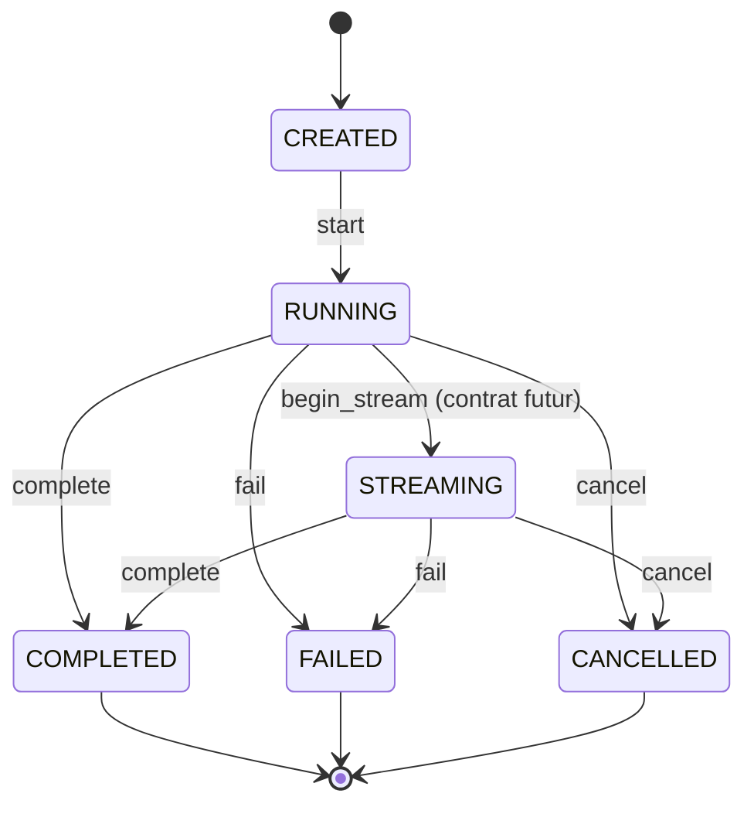

# 03_PYLLMKIT_PHASE_3_IMPLEMENTATION_PLAN

**Mise a jour du 2026-11-05 : P3-G0 GO architecture avec reserves** apres adoption owner ADR-014..021 ([PR #19](https://github.com/tawounfouet/pyllmkit/pull/19), `main` SHA `965311dbef527ad59222b7586f9c801bb713bead`, [CI SUCCESS](https://github.com/tawounfouet/pyllmkit/actions/runs/42029448967)). Voir [PV de gate](quality/P3_G0_GATE_REVIEW.md). Les formulations historiques *plan propose / ADR a arbitrer* ci-dessous documentent l'etat d'origine. L3.1..L3.5 restent a realiser; P3-AC-007 requis (ADR-021 option A), aucune publication.


> **Projet :** PyLLMKit  
> **Phase :** P3 - Inference Primitives  
> **Incrément visé :** `0.1.0a3`  
> **Jalon cible :** M3 - Inference Foundations Qualified  
> **Statut :** PLAN PROPOSÉ - à revoir, arbitrer et approuver au gate P3-G0  
> **Date de référence :** 5 novembre 2026  
> **Langue :** français, noms des primitives Python en anglais  
> **Nature :** plan d'implémentation et contrat de qualification, pas un compte rendu d'exécution  
> **Publication :** aucune publication autorisée par ce plan.

---

## 0. Résumé exécutif

L'objectif de `0.1.0a3` est de faire évoluer PyLLMKit d'une **bibliothèque qui décrit les modèles et les interactions** vers une bibliothèque qui **représente formellement l'intention d'inférence, le résultat et le cycle d'une exécution**. Cet incrément ne doit pas se transformer prématurément en SDK OpenAI/Anthropic, en orchestrateur d'agents ou en client HTTP.

La séparation fondatrice est :

```text
Model Domain (M1)         Interaction Domain (M2)
Model / Capability        Role / Message / Content
Modality / Limits         TextContent / ImageContent / MediaSourceRef
         \                         /
          \                       /
           v                     v
          InferenceRequest (intention immuable)
                    |
                    v
          InferenceRun (exécution, identité, état)
                    |
                    v
          InferenceResponse (résultat immuable)
                    |
                    v
          TextOutput + FinishReason + Usage?

     Domaine pur, sans I/O ni adaptateur fournisseur
```

Le lot est organisé comme suit :

| Lot | Sujet | Livrable principal | Gate |
|---|---|---|---|
| P3-BOOT | Architecture et ADR | Décisions prises sur les contrats publics et frontières | P3-G0 |
| L3.1 | Request Domain | `InferenceTarget`, `GenerationConfig`, `InferenceRequest` | P3-G1 |
| L3.2 | Response Domain | `TextOutput`, `FinishReason`, `Usage`, `InferenceResponse` | P3-G2 |
| L3.3 | Run Domain | `InferenceRunId`, `InferenceRunState`, `InferenceRun`, transitions | P3-G3 |
| L3.4 | Codecs, intégrité et tests | Contrat JSON Inference v1 indépendant, tests négatifs et non-régression | P3-G4 |
| L3.5 | Intégration et qualification | Docs, exemples, wheel/sdist, preuves `main` | P3-G5 |
| M3 | Qualification globale | GO/NO-GO technique sur le SHA final de `main` | M3 |

**Attention :** le corpus fondateur décrit également les ports d'invocation, les tools, les formats structurés, le streaming, les providers, le pricing et le registry. Leur existence dans la vision n'implique pas qu'ils doivent tous être implémentés en `0.1.0a3`. Les frontières et reports proposés ci-dessous sont des **arbitrages de planification à accepter en G0**, pas des décisions déjà adoptées.

---

## 1. Point de départ vérifié

### 1.1. Baseline M2

Le dépôt `tawounfouet/pyllmkit` a été consulté après la clôture M2. État observé :

| Élément | État vérifié |
|---|---|
| Branche de référence | `main` |
| SHA final M2 archivé | `acd6dfb76d73c260ccca523cf904be44ec249288` |
| CI finale M2 | [GitHub Actions #42016493260](https://github.com/tawounfouet/pyllmkit/actions/runs/42016493260), `SUCCESS` |
| Versions Python | 3.11, 3.12, 3.13 : 3/3 succès |
| Tests | **342 passed** |
| Couverture combinée avec branches | **91 %**, mesure observée, pas un seuil contractuel |
| Qualité | Ruff et mypy strict réussis, 26 fichiers source vérifiés par mypy |
| Distribution construite | Wheel et sdist du candidat `0.1.0a2`, installations isolées réussies |
| Public API M1 | Model, identité, capacités, modalités, schéma Model v1 |
| Public API M2 | Role, Message, Content, ContentPart, TextContent, ImageContent, MediaSourceRef |
| Codec M2 | `INTERACTION_SCHEMA_VERSION = 1`, `message_to_dict` / `message_from_dict` |
| Release GitHub / tag | Aucune release et aucun tag observés au contrôle de départ |
| Publication PyPI | Aucune publication revendiquée ni autorisée par M2; une absence absolue sur l'index externe n'a pas été vérifiée ici |
| Gouvernance `main` | `protected: false` au contrôle de départ |

Le jalon M2 a qualifié la **représentation** et la **sérialisation** d'interactions. Il n'a pas livré `InferenceRequest`, `InferenceRun`, `InferenceResponse` ou un moteur capable de solliciter un fournisseur.

Références : [M2 Gate Review](https://github.com/tawounfouet/pyllmkit/blob/main/docs/quality/M2_GATE_REVIEW.md), [Interaction API](https://github.com/tawounfouet/pyllmkit/blob/main/docs/api/interaction.md), [ROADMAP](https://github.com/tawounfouet/pyllmkit/blob/main/ROADMAP.md).

### 1.2. Sources de conception

| Source | Contribution à P3 | Nature |
|---|---|---|
| `00_PYLLMKIT_EXPRESSION_DU_BESOIN.md` | Motivation et expression des usages LLM | Source fondatrice fournie |
| `01_PYLLMKIT_REQUIREMENTS_ANALYSIS.md` | UC-008/009, FR-016..021, FR-030, INV-011..018, MVP-3 | Exigences de référence |
| `02_PYLLMKIT_PRODUCT_VISION_AND_ARCHITECTURE_PRINCIPLES.md` | Domain First, provider-agnostic, architecture par phases | Principes directeurs |
| `03_PYLLMKIT_SYSTEM_ARCHITECTURE.md` | Request/Target/Config/Run/Response, port générique et séparation des couches | Architecture cible, pas API déjà figée |
| `04_PYLLMKIT_DOMAIN_OBJECTS.md` | Catalogue conceptuel des objets d'inférence | Inventaire de conception |
| `05_PYLLMKIT_ENTITIES_AND_VALUE_OBJECTS.md` | Request/Response VOs, Run Aggregate Root | Classification DDD proposée |
| `06_PYLLMKIT_DOMAIN_RELATIONSHIPS_AND_ERD.md` | Cardinalités Request/Run/Response/Usage et cible | Modèle relationnel cible |
| `07_PYLLMKIT_DOMAIN_INVARIANTS_AND_BUSINESS_RULES.md` | INF-001..029, USG-001..006, INV-007/008 | Invariants métier |
| `08_PYLLMKIT_COMMANDS_QUERIES_AND_USE_CASES.md` | Create/Validate/Start/Complete/Fail/Cancel, ports | Cas d'usage cibles |
| `09_PYLLMKIT_DOMAIN_EVENTS_CATALOG.md` | InferenceStarted/Completed/Failed/Cancelled | Événements métier cibles |
| `02_PYLLMKIT_PHASE_2_IMPLEMENTATION_PLAN.md` | Discipline G0..M2, PR, tests et qualification | Précédent méthodologique |
| `PYLLMKIT_PHASE_2_POST_IMPLEMENTATION_REVIEW.md` | Transition recommandée, dette PIR2-01..13 | Bilan M2, recommandations distinctes des exigences |
| GitHub `main` après PR #18 | Code et preuve d'intégration réels | Baseline technique vérifiée |

**Règle de lecture :** les exigences fondateurs sont conservées comme source. Les signatures et politiques précises de `0.1.0a3` présentées dans ce plan sont des propositions de conception. Les ADR de Phase 3 devront les confirmer ou les modifier explicitement.

### 1.3. Héritage à préserver

1. Importer les types M1 et M2 **sans rupture** des noms ni des chemins publics adoptés.
2. Ne pas modifier les formats JSON Model v1 et Interaction v1 en douce.
3. Ne pas ajouter d'obligation de `Conversation`, `Deployment`, `Endpoint`, compte provider ou client réseau pour construire une demande.
4. Garder les valeurs absentes distinctes de zéro, `False`, vide, `UNKNOWN` ou d'une valeur inventée.
5. Conserver le contrat `Content` ordonné et les références `MediaSourceRef` passives.
6. Ne pas considérer `Capability` ou `Modality` comme preuve automatique de disponibilité effective d'une cible.
7. Garder `0.1.0a2` comme candidat de référence, sans prétendre qu'il a été publié.

---

## 2. Objectifs, critères de succès et exclusions

### 2.1. Objectifs fonctionnels MUST

- **P3-OBJ-01** : construire une requête d'inférence typée, immuable et provider-agnostic.
- **P3-OBJ-02** : représenter au moins une cible explicite; choisir en ADR comment exprimer Model, Deployment et Endpoint sans exiger les entités non implémentées.
- **P3-OBJ-03** : exprimer les paramètres génériques de génération via un `GenerationConfig` dédié, avec absence explicite et validation des types.
- **P3-OBJ-04** : représenter une réponse normalisée, textuelle dans le MVP, avec raison d'arrêt et usage optionnel.
- **P3-OBJ-05** : représenter les métriques d'usage observées sans les assimiler au pricing ou au coût.
- **P3-OBJ-06** : modéliser un run concret, distinct de la requête et de la réponse, doté d'un état et de transitions valides.
- **P3-OBJ-07** : fournir les conversions JSON versionnées nécessaires à la persistance/inspection des primitives approuvées, sans réutiliser les versions M1/M2.
- **P3-OBJ-08** : maintenir la compatibilité des domaines M1/M2 et le caractère offline du Domain Core.
- **P3-OBJ-09** : qualifier le candidat `0.1.0a3` par CI complète, artefacts installables, tests d'acceptation et décision M3.

### 2.2. SHOULD conditionnels, soumis à G0

- Rapporter les paramètres non supportés par une cible lorsque les **capacités et limites effectives** sont réellement disponibles, au moyen d'un contrat de validation séparé et de résultats typés.
- Définir un port d'invocation **structurel** (`Protocol`) pour les futures couches application/adapters, testé par un fake offline, sans implémenter d'appel distant.
- Définir une politique normalisée minimale de `InferenceFailure`/`RunFailure`, sans emprunter les exceptions natives des SDK.
- Prévoir des événements métier de transitions sous forme d'enveloppes immuables ou de spécifications, sans imposer un bus d'événements.
- Accepter une cible `DeploymentTarget` ou `EndpointTarget` à identité opaque si l'ADR confirme que cela ne suppose pas de résoudre un vrai deployment/endpoint.

### 2.3. Hors scope explicite pour `0.1.0a3`

| Exclusion | Trajectoire envisagée | Motif |
|---|---|---|
| Appels HTTP réels, authentification provider, SDK OpenAI/Anthropic/Google/... | Adapters `0.2.x` ou incrément dédié | Ne pas confondre Domain Primitives et transport |
| Exécution distante effective de `invoke` | Après contrats applicatifs et adapters | Aucun fournisseur ni runtime d'inférence ne doit être simulé comme opérationnel |
| Streaming, `TextDelta`, `ResponseStarted`, événements de flux | `0.1.0b1` selon roadmap | Modèle de flux distinct de la réponse finale |
| Tools, ToolCall/ToolResult, ToolChoice, exécution de fonctions | `0.1.0a4` | Contrat dédié et versionnement extensible |
| Structured Output / JSON Schema output | `0.1.0a4` | Validation et compatibilité distinctes |
| Image/audio/video **output** et embeddings | Incréments ultérieurs | TextOutput seulement dans le MVP proposé |
| Tokenizer concret et estimation de tokens provider | Lot dédié | Dépendance aux familles et déploiements |
| Pricing effectif et facturation | Après modèle Usage | `Usage != Pricing != Cost` |
| Registry, discovery et résolution réelle d'un deployment | `0.1.0b2` et phases de serving | Entités et règles pas encore livrées |
| Automatisation de retry, timeouts réseau, circuit breakers | Application/infrastructure | Nécessite un client réel et politique d'idempotence |
| ORM, tables, transactions, UoW durable | Future couche persistence | Pas de stockage imposé au Domain Core |
| Agrégat Conversation obligatoire | Toujours optionnel selon ADR-009 | Préserver M2 |
| Nouveau schéma Interaction v2 | Seulement avec ADR spécifique | Le v1 texte/image est gelé pour cet incrément |

Les exclusions qui touchent une exigence fondatrice sont des **reports de version** à documenter. Elles ne signifient pas que l'exigence a disparu du produit.

### 2.4. Définition générale d'un succès M3

Un consommateur de la bibliothèque pourra, avec Python uniquement et **sans clé API**, construire une `InferenceRequest`, représenter une réponse textuelle normalisée, simuler de façon déterministe les transitions d'un `InferenceRun`, convertir les objets approuvés en JSON puis les relire à l'identique, et exécuter ces exemples depuis une wheel ou un sdist isolé.

Cela **ne prouve pas** qu'il peut appeler un vrai modèle d'IA. Le README doit éviter toute formulation ambiguë sur ce point.

---

## 3. Architecture cible et frontières de responsabilité

### 3.1. Bounded contexts

```text
+------------------------------------------------------------+
| Consumer (script / notebook / test)                        |
+------------------------------------------------------------+
                     |
                     v
+------------------------------------------------------------+
| Inference Domain (new in a3)                               |
|   Target, GenerationConfig, InferenceRequest                 |
|   TextOutput, FinishReason, Usage, InferenceResponse        |
|   InferenceRunId, InferenceRunState, InferenceRun            |
|   Independent JSON codec v1                                 |
+------------------------------------------------------------+
            |                             |
            v                             v
+-----------------------------+ +----------------------------+
| Model Domain (M1)           | | Interaction Domain (M2)    |
| ModelId, Model, Capabilities| | Message, Content, Parts    |
| Modalities, Limits          | | Interaction codec v1       |
+-----------------------------+ +----------------------------+

       FUTURE APPLICATION / ADAPTER BOUNDARY
       (CompatibilityResolver, Invoker, Network, Providers)
       Not part of the Domain Core and not operational in a3.
```

**Règle de dépendance :** `domain.inference` peut dépendre des **types de domaine stables** de `domain.models`, `domain.modalities`, `domain.capabilities` et `domain.interactions` lorsque cette dépendance est justifiée; il ne doit dépendre ni d'`application`, ni d'`infrastructure`, ni de `providers`, ni d'un SDK externe.

### 3.2. Structure de répertoire proposée

```text
src/pyllmkit/
  domain/
    inference/
      __init__.py
      target.py               # InferenceTarget / variants
      config.py               # GenerationConfig
      request.py              # InferenceRequest
      output.py               # InferenceOutput / TextOutput
      finish.py               # FinishReasonCode / FinishReason
      usage.py                # Usage
      response.py             # InferenceResponse
      run.py                  # InferenceRunId, State, Run
      errors.py               # errors de domaine si nécessaires
      serialization.py        # codecs Inference v1, ADR dédiée
    interactions/             # M2, ne pas modifier les schémas v1
    models/                   # M1, ne pas modifier les schémas v1
    capabilities/             # M1
    modalities/              # M1

# Contrat optionnel si accepté en G0 :
src/pyllmkit/protocols/inference.py  # port Protocol uniquement

tests/unit/domain/inference/
tests/serialization/test_inference_codec.py
tests/acceptance/test_ac_008_request.py
tests/acceptance/test_ac_009_response.py
tests/acceptance/test_ac_010_run_lifecycle.py
tests/architecture/test_p3_boundaries.py
examples/08_define_inference_request.py
examples/09_define_inference_response.py
examples/10_simulate_inference_run.py
examples/11_round_trip_inference.py
docs/adr/ADR-014-*.md ... ADR-021-*.md
docs/concepts/inference*.md
docs/api/inference.md
docs/architecture/INFERENCE_JSON_SCHEMA_V1.md
docs/quality/P3_*.md
```

Les noms de tests `AC-008` à `AC-010` ci-dessus sont **identifiants d'acceptation P3 proposés**, et non des exigences AC déjà présentes et approuvées dans le corpus. Les invariants `INF-*` et `USG-*`, en revanche, proviennent des spécifications.

### 3.3. Notions à ne jamais fusionner

| Concept | Identité et responsabilité |
|---|---|
| `InferenceRequest` | Intention de génération, immuable, égalité par valeur |
| `InferenceRun` | Exécution concrète, identité stable, cycle de vie, tentatives |
| `InferenceResponse` | Résultat normalisé d'un run, snapshot immuable |
| `Message` | Interaction, non une requête réseau |
| `InferenceTarget` | Référence de ciblage, pas une instance d'un modèle exécuté |
| `GenerationConfig` | Options génériques souhaitées, pas options natives fournisseur |
| `Usage` | Mesures de consommation, pas tarification |
| `FinishReason` | Explication normalisée de l'arrêt, pas état du run |
| `Capability` | Capacité déclarée, pas nécessairement support effectif |

### 3.4. Ports & Adapters / séparation des responsabilités

1. **Domain Core :** définitions, validations de structure, transitions métier pures, normalisation de valeurs connues et codecs.
2. **Application :** résolution de cible, validation de compatibilité effective, orchestration et gestion d'éventuelles transactions/événements.
3. **Ports :** interfaces de capacités requises par l'application, éventuellement un port d'invocation, sans politique cachée.
4. **Adapters :** transport, authentification, traduction de paramètres, normalisation des réponses natives, SSRF, redirection et quotas.
5. **Observabilité future :** corrélation par `run_id`, redaction et événements sans exposer secrets ni payload brut.

Un `FakeInferenceInvoker` offline est un moyen de **tester un port**, pas de démontrer une capacité à appeler un modèle réel.

---

## 4. P3-BOOT : décisions d'architecture à prendre avant le code public

### 4.1. Registre ADR proposé

| ADR proposé | Décision attendue | Question principale | Statut initial |
|---|---|---|---|
| **ADR-014** | Frontières Request / Run / Response | VOs, Aggregate Root et agrégats associés ? | PROPOSED |
| **ADR-015** | InferenceTarget | Modèle uniquement ou trois variantes, identifiants et résolution ? | PROPOSED |
| **ADR-016** | GenerationConfig et support de paramètres | Types, `None`, bornes, validation structurelle vs effective ? | PROPOSED |
| **ADR-017** | InferenceOutput et FinishReason | Sortie textuelle minimale, raisons normalisées et valeur native ? | PROPOSED |
| **ADR-018** | Usage, comptages et données manquantes | Champs, `total_tokens`, métriques avancées et provenance ? | PROPOSED |
| **ADR-019** | InferenceRun lifecycle | États, transitions, identité, horloge, retries et erreurs ? | PROPOSED |
| **ADR-020** | Inference JSON v1 | Schéma, `object_type`, relation au codec Interaction, compatibilité ? | PROPOSED |
| **ADR-021** | Port et compatibilité effective | Port in a3 ou futur, erreurs et politique des paramètres non supportés ? | PROPOSED / optionnel |

**Aucune de ces ADR n'est déclarée acceptée dans ce plan.** La rédaction des ADR, une revue contradictoire, puis une décision explicite du propriétaire du projet constituent G0. Le statut `ACCEPTED` ne doit pas être inventé à partir de la seule présence du fichier.

### 4.2. Questions bloquantes à trancher en G0

1. Un `InferenceRequest` pour chat exige-t-il au moins un `Message` ? La relation fondatrice autorise conceptuellement `0..*` messages; l'API de chat proposée peut choisir `1..*` **si elle est explicitement limitée au chat**. Ne pas effacer cette différence.
2. `ModelTarget`, `DeploymentTarget` et `EndpointTarget` sont-ils trois VOs publics ou des alternatives ultérieures ? Le dépôt M2 ne comporte pas les entités concrètes Deployment/Endpoint.
3. Les identifiants de requête servent-ils uniquement à la corrélation ou constituent-ils une identité métier ? Ne pas faire de `InferenceRequest` une Entity par simple ajout d'un UUID.
4. Les paramètres optionnels sont-ils `None`, un sentinelle `UNSET` ou des champs explicitement présents ? Quel comportement pour `0`, `False`, `()` et les valeurs non finies ?
5. Une réponse peut-elle être vide ? Le modèle fondateur demande un `output` (INF-024), sauf variante explicite future.
6. Une `FinishReason` inconnue garde-t-elle une valeur native ? Comment représenter `CANCELLED` en tant que raison de sortie sans la confondre avec l'état d'un run ?
7. Quel schéma v1 encoder pour `InferenceRun` en présence de timestamps et d'événements ?
8. Le run est-il un objet mutable encapsulé, ou une suite de snapshots immuables qui portent la même identité ? Les deux préservent DDD si le contrat est testé, mais les compromis diffèrent.
9. Quelles métriques d'Usage sont garanties, optionnelles ou provider-specific ?
10. Où et par qui la compatibilité effective (`image input`, paramètres non supportés, limites) est-elle déterminée si aucune cible opérationnelle n'est résolue ?
11. Les événements domaine sont-ils exposés en `a3` comme objets, ou limités à un catalogue et à des tests de transition ?
12. Le codec Inference incorpore-t-il les mappings Interaction v1 tels quels ou une représentation interne plus compacte ? Toute réécriture doit être justifiée, testée et versionnée.

### 4.3. Entrée / sortie du gate P3-G0

**Entrée :** M2 final vérifié, PIR Phase 2, exigences fondatrices, code et tests existants.  
**Sortie :** ADR-014..020 décidées, vocabulaire public stabilisé, lotissement P3/PR, délimitations et matrice d'acceptation approuvés.  
**NO-GO :** signature publique ambiguë sur target ou request, scope fournisseur caché, sérialisation sans politique, ou ADR annoncées acceptées sans décision.

---

## 5. L3.1 - Inference Request Domain

### 5.1. `InferenceTarget` : proposition de modèle

Les sources décrivent trois niveaux :

```text
InferenceTarget
  |- ModelTarget        -> ModelId
  |- DeploymentTarget   -> référence opaque de deployment
  '- EndpointTarget     -> référence opaque d'endpoint
```

**Choix proposé, non encore approuvé :** implémenter les trois discriminants comme VOs immuables, mais ne créer **aucune** fausse entité Deployment/Endpoint et n'effectuer aucune résolution automatique. La variante `ModelTarget` peut réutiliser `ModelId` de M1. Les autres identifiants doivent avoir un contrat minimal explicite adopté en ADR (chaîne non vide et type distinct), sans URL réseau implicite.

**Invariants candidats :** exactement une cible, type explicite, identifiant valide, aucune lecture du registry, aucune URL téléchargée, aucun mapping provider silencieux. Un target n'implique pas qu'une cible existe réellement ni qu'elle accepte les modalités/paramètres demandés.

### 5.2. `GenerationConfig` : proposition de contrat

| Champ candidat | Type de domaine proposé | Sens d'absence | Validation de structure proposée |
|---|---|---|---|
| `temperature` | `float | None` | non spécifié | nombre réel fini; bornes approuvées par ADR |
| `top_p` | `float | None` | non spécifié | fini, dans l'intervalle décidé en ADR |
| `top_k` | `int | None` | non spécifié | entier non booléen, domaine décidé en ADR |
| `max_output_tokens` | `int | None` | non spécifié | entier non booléen, strictement positif proposé |
| `seed` | `int | None` | non spécifié | entier non booléen; politique de signe décidée en ADR |
| `stop_sequences` | `tuple[str, ...] | None` | non spécifié | tuple exact, chaînes exactes, duplications conservées ou rejet selon ADR |
| `presence_penalty` | `float | None` | non spécifié | réel fini; support réel évalué ailleurs |
| `frequency_penalty` | `float | None` | non spécifié | réel fini; support réel évalué ailleurs |

**Nommage :** le corpus utilise notamment `max_tokens`; `max_output_tokens` est une proposition de nom de domaine plus explicite. Ce renommage doit être accepté ou rejeté en G0, sans le présenter comme exigence historique.

Règles essentielles :

- INF-001 : VO immuable (par exemple `@dataclass(frozen=True, slots=True)`).
- INF-002 : champ absent `None` ou sentinelle dédiée = **non spécifié**, jamais une valeur par défaut universelle.
- INF-003 : rejeter `bool` lorsque nombre attendu, `NaN`, infini, nombres invalides, tuples mal typés, valeurs interdites par la politique approuvée.
- INF-004 : l'existence d'un champ ne garantit pas le support par une cible; une validation de compatibilité séparée doit rapporter les paramètres non supportés.
- INF-005 : ne pas glisser des options natives dans `GenerationConfig`. Un futur `ProviderOptions` doit être distinct et optionnel, selon une ADR.
- Pas de coercition silencieuse, pas d'effet de bord, pas d'appel SDK.

### 5.3. `InferenceRequest` : Value Object

Signature **illustrative, à ne pas publier avant ADR** :

```python
@dataclass(frozen=True, slots=True)
class InferenceRequest:
    target: InferenceTarget
    messages: tuple[Message, ...]
    generation_config: GenerationConfig | None = None
```

Cette signature ne présume pas l'existence des classes dans M2. Les métadonnées, tools, response format et provider options sont présentes dans le modèle conceptuel, mais il faut trancher les champs conservés dans `a3` sans introduire de `dict[str, Any]` mutable ou non maîtrisé.

**Scénario cible P0 :** une requête chat valide avec cible et messages typés, création offline, conservation de l'ordre des messages et des ContentParts, sérialisation réversible. **Aucun mapping des rôles** n'est effectué dans le Domain Core.

La validation se divise en deux :

| Niveau | Responsable | Peut s'exécuter offline ? |
|---|---|---|
| Structure (target, types, cardinalités, config) | Domain Core | Oui, toujours |
| Compatibilité effective (Model/Deployment/Endpoint, paramètres, capacité vision, limites) | Future application + résolution de cible | Oui si snapshot complet fourni; sinon résultat `UNKNOWN` ou non évalué |
| Traduction provider et exécution | Future adapter | Non, hors `a3` |

L'invariant INF-011 (ImageContent exige input IMAGE) doit être **respecté sans supposer la capability**. En absence de cible résolue, construire un objet structurellement valide est possible; l'exécuter doit rester interdit tant que la compatibilité pertinente n'est pas évaluée par une couche habilitée.

### 5.4. Backlog L3.1

| ID | Tâche | Priorité | Preuve exigée |
|---|---|---|---|
| `P3-L31-T01` | Définir/discuter les trois variantes d'InferenceTarget (ADR-015) | P0 | Cas Model/Deployment/Endpoint et limites explicités |
| `P3-L31-T02` | Implémenter les types de target validés et leurs invariants | P0 | Tests positifs/négatifs, valeur, hash et immutabilité |
| `P3-L31-T03` | Décider et coder la structure de `GenerationConfig` | P0 | INF-001..005, absence vs zéro, float fini, bool exclus |
| `P3-L31-T04` | Définir `InferenceRequest` comme VO et cardinalités | P0 | INF-006..008 et INT-001/002 |
| `P3-L31-T05` | Valider types et ordre des messages multimodaux | P0 | Texte/image sans transformation ni capacité inventée |
| `P3-L31-T06` | Définir erreur de validation de request | P0 | `DomainValidationError` et éventuels sous-types approuvés |
| `P3-L31-T07` | Délimiter `ProviderOptions`, tools, response_format (non implémentés) | P0 | Pas de champs faux ou d'extension implicite |
| `P3-L31-T08` | Décrire `BuildInferenceRequest` comme cas d'usage pur si utile | P1 | Exemple offline, pas de factory inutile |
| `P3-L31-T09` | Documenter validation structurelle vs effective | P0 | Contrat incapable de prétendre que vision est supportée |
| `P3-L31-T10` | Tester imports publics racine et sous-package | P0 | M1/M2 inchangés, pas de cycle d'import |

### 5.5. Gate P3-G1 - Request Ready

- Les targets adoptés sont immuables et discriminés.
- `GenerationConfig` respecte les validations structurelles et le sens des absences.
- Une `InferenceRequest` est construite avec des `Message` M2 sans `Conversation` ni provider.
- L'ordre des messages et des parties est conservé.
- Les paramètres inconnus, la vision effective et les options natives **ne sont pas déclarés supportés par défaut**.
- Suite Python/ruff/mypy et tests M1/M2 verts sur le SHA qualifiant.

---

## 6. L3.2 - Inference Response Domain

### 6.1. `InferenceOutput` et `TextOutput`

Le corpus envisage une famille polymorphe de sorties (texte, JSON, tool calls, embedding, image, audio et multipart). Pour `0.1.0a3`, le **P0 proposé** est un `TextOutput(text: str)` immuable, avec un type parent explicite seulement si la politique d'extension est approuvée.

- Une sortie textuelle vide peut être représentée **si** l'ADR décide que `""` est un résultat valide, distinct d'une réponse sans output.
- Aucun tool call ou output structuré ne doit être inventé sous une forme textuelle silencieuse.
- L'ordre et l'égalité des valeurs doivent être déterministes.
- Aucun `ImageContent` reçu en entrée n'implique une `ImageOutput` disponible en sortie.

### 6.2. `FinishReason` et origine native

Taxonomie conceptuelle de référence : `STOP`, `LENGTH`, `TOOL_CALL`, `CONTENT_FILTER`, `CANCELLED`, `ERROR`, `UNKNOWN`.

**Proposition :** un `FinishReasonCode` symbolique fermé et un VO `FinishReason(normalized, native_reason: str | None)` immuable. Le code `UNKNOWN` est explicite, jamais remplacé par `STOP` en l'absence d'information; la valeur native, si autorisée, est conservée comme donnée (pas comme permission d'exécuter une branche de code).

Une valeur `TOOL_CALL` peut être **représentée** sans promettre qu'un objet `ToolCall` exécutable est disponible en `a3`. Son exploitation est réservée à `0.1.0a4`.

### 6.3. `Usage` et métriques manquantes

| Champ proposé | Type | Sémantique |
|---|---|---|
| `input_tokens` | `int | None` | Mesure observée ou absente |
| `output_tokens` | `int | None` | Mesure observée ou absente |
| `total_tokens` | `int | None` | Valeur fournie ou calcul admis **uniquement** si la convention le permet |
| `reasoning_tokens` | `int | None` | Sous-métrique explicite, jamais inventée |
| `cached_input_tokens` | `int | None` | Sous-métrique distincte si disponible |
| `provider_metrics` | Future extension typée | Pas de `dict` mutable arbitraire en P0 |

Les noms exacts, la relation entre `total_tokens` et ses composants, et les unités doivent être arbitrés dans ADR-018. **Ne pas imposer `total = input + output` à tous les providers par hypothèse** si leurs métriques comptabilisées diffèrent. L'invariant minimal est : nombres entiers non négatifs (hors booléens), données absentes non remplacées par zéro, pas de calcul de coût sans pricing.

### 6.4. `InferenceResponse` : Value Object

Structure de référence :

```text
InferenceResponse
  |- run_id: InferenceRunId (correlation)
  |- output: TextOutput (P0 a3)
  |- finish_reason: FinishReason? (UNKNOWN explicite si choisi)
  |- usage: Usage? (optionnel)
  '- model/deployment/raw/metadata (décision et reports explicites)
```

**Important :** la source appelle `InferenceResponse` un Value Object, lié à un run mais sans cycle de vie propre. La réponse finale appartient à **une exécution identifiée**. Les champs `raw` et `provider_request_id`, quand ils existent, doivent rester isolés des champs métier et être soumis à une politique de secrets/redaction; aucun dump natif n'est nécessaire au P0.

### 6.5. Backlog L3.2

| ID | Tâche | Priorité | Preuve exigée |
|---|---|---|---|
| `P3-L32-T01` | Décider famille Output et TextOutput MVP (ADR-017) | P0 | Sortie non ambiguë et types explicites |
| `P3-L32-T02` | Implémenter `TextOutput` immuable | P0 | Tests Unicode, vide si autorisé, invalides |
| `P3-L32-T03` | Implémenter `FinishReason` normalisé/natif | P0 | STOP/LENGTH/UNKNOWN, pas de fallback implicite |
| `P3-L32-T04` | Décider et implémenter `Usage` (ADR-018) | P0 | USG-001..006, absence, entiers non booléens |
| `P3-L32-T05` | Implémenter `InferenceResponse` et corrélation RunId | P0 | INF-022..029 compatibles avec périmètre retenu |
| `P3-L32-T06` | Délimiter raw payload et metadata (futures) | P0 | Aucune donnée native exposée accidentellement |
| `P3-L32-T07` | Tester réponse normalisée sans provider | P0 | Valeur et invariants déterministes |
| `P3-L32-T08` | Tests négatifs de `FinishReason` et `Usage` | P0 | Types invalides, données absentes, `UNKNOWN` |
| `P3-L32-T09` | Documenter usage vs pricing vs cost | P0 | Aucun prix ni coût simulé |

### 6.6. Gate P3-G2 - Response Ready

- Réponse textuelle normalisée indépendante du provider.
- Liaison à un run explicite sans assimilation de la réponse à l'entité run.
- `FinishReason` manquante/inconnue traitée sans valeur inventée.
- `Usage` optionnel et validé, sans approximation financière automatique.
- M1/M2 et G1 toujours verts.

---

## 7. L3.3 - InferenceRun : Aggregate et machine à états

### 7.1. Modèle de domaine

L'`InferenceRun` proposé est une **Entity / Aggregate Root** au sens DDD, pas un VO. Il porte une identité stable `InferenceRunId`, référence exactement une intention d'inférence, suit une tentative et possède un état métier.

Le design doit distinguer :

```text
InferenceRequest (Value Object)
      |
      | 1 request logique -> 0..* runs
      v
InferenceRun (Aggregate Root, identité stable)
      |- id: InferenceRunId
      |- request: InferenceRequest (ou ref si ADR)
      |- attempt: int
      |- state: InferenceRunState
      |- started_at? / completed_at? (horloge injectée)
      |- response?: InferenceResponse (uniquement état compatible)
      '- failure?: InferenceFailure (uniquement état compatible)
```

La forme interne peut être une entité encapsulée mutable **ou** une succession de snapshots immuables avec le même `RunId`. La décision doit être enregistrée en ADR-019, documenter l'égalité par identité et tester l'absence de mutations non contrôlées.

### 7.2. Machine à états proposée (conforme au corpus)



**Nuance :** la transition vers `STREAMING` peut être réservée en `a3` à la **sémantique d'état** (sans fournir de `StreamEvent` ni d'API de streaming). Si aucune transition concrète ne la déclenche, elle doit être annoncée comme réserve future, et non comme streaming opérationnel.

Transitions terminales irréversibles : `COMPLETED`, `FAILED`, `CANCELLED` ne repartent jamais en `RUNNING` ou `STREAMING`. Les chemins non représentés sont rejetés, jamais auto-corrigés.

### 7.3. Règles d'identité, d'horloge et d'erreur

- `InferenceRunId` est stable, strictement typé et non vide. Génération d'ID par caller ou port/factory injectée, pas de `uuid4()` caché dans un VO de request.
- `attempt` est un entier strictement positif pour une exécution réelle. Plusieurs runs peuvent référencer la même request (replay, retry externe, benchmark).
- L'horloge doit être **injectée** lors des transitions ou via un objet déterministe; aucune dépendance aux `datetime.now()` implicites dans les tests.
- Utiliser des instants timezone-aware si retenus; valider les ordres temporels (début <= fin). Les conventions d'horodatage sont à formaliser en ADR.
- `COMPLETED` exige une réponse compatible et **aucune** erreur terminale.
- `FAILED` n'admet pas une réponse finale valide, sauf modèle de réponse partielle explicitement adopté dans un autre incrément.
- `CANCELLED` est terminal; la distinction annulation demandée / annulation confirmée doit être formulée si elle devient opérationnelle.
- `InferenceResponse.run_id` doit correspondre à l'`InferenceRunId` du run complété; une réponse d'un autre run est rejetée.
- Les tentatives et erreurs ne doivent pas contenir de secret, de prompt brut ou de payload média dans `repr`, logs ou événements par défaut.
- La machine d'états n'exécute **aucune** requête réseau. Un `complete()` purement métier ne prouve pas qu'un provider a répondu.

### 7.4. Commandes et événements proposés

| Commande métier | Entrée minimale | Transition | Événement conceptuel |
|---|---|---|---|
| `StartInferenceRun` | request, run_id, attempt, horodatage | CREATED -> RUNNING | `InferenceStarted` |
| `CompleteInferenceRun` | run_id, response, horodatage | RUNNING/STREAMING -> COMPLETED | `InferenceCompleted` |
| `FailInferenceRun` | run_id, erreur normalisée, horodatage | RUNNING/STREAMING -> FAILED | `InferenceFailed` |
| `CancelInferenceRun` | run_id, motif optionnel | RUNNING/STREAMING -> CANCELLED | `InferenceCancelled` |

Le corpus comprend aussi `InferenceStreamingStarted` et des événements de flux. Leur **catalogue** peut être préparé en a3, mais leurs classes et dispatch réels sont différés au streaming. Aucun event bus, outbox, scheduler ni repository n'est requis pour qualifier la machine métier.

### 7.5. Backlog L3.3

| ID | Tâche | Priorité | Preuve exigée |
|---|---|---|---|
| `P3-L33-T01` | Trancher agrégat, identité et snapshot/mutabilité (ADR-019) | P0 | Égalité par ID et périmètre Aggregate Root définis |
| `P3-L33-T02` | Implémenter `InferenceRunId` et état typé | P0 | Rejet IDs invalides, enum explicite |
| `P3-L33-T03` | Implémenter la création d'un run lié à une request | P0 | 1 request par run, attempts validés |
| `P3-L33-T04` | Implémenter `start`, `complete`, `fail`, `cancel` | P0 | Matrice transitions positives/négatives |
| `P3-L33-T05` | Valider terminalité et invariants réponse/erreur | P0 | INF-017..019, INF-023 |
| `P3-L33-T06` | Introduire horloge explicite et timestamps si adoptés | P0 | Tests reproductibles, temps cohérents |
| `P3-L33-T07` | Décider portée de `STREAMING` à a3 | P0 | État documenté sans faux support streaming |
| `P3-L33-T08` | Modéliser erreur normalisée de run si nécessaire | P1 | Error Model distinct du transport natif |
| `P3-L33-T09` | Formaliser les événements de transition sans bus | P1 | 1 seul terminal event logique, pas de secret |
| `P3-L33-T10` | Tester plusieurs runs pour une même request | P0 | Id distinct, request réutilisable |

### 7.6. Gate P3-G3 - Run Lifecycle Ready

- ID stable, transitions légales et états terminaux irréversibles.
- Une même request peut donner lieu à plusieurs runs indépendants.
- Une réponse ne peut être liée à un autre run.
- Événements/horodatages déterministes selon le contrat approuvé.
- Aucun runtime, transport ou IO caché n'est requis.
- G1 et G2 maintenus au vert.

---

## 8. L3.4 - Inference JSON v1, contrats et sérialisation

### 8.1. Principe de versionnement

Les deux namespaces existants doivent demeurer distincts :

```text
Model Domain       SCHEMA_VERSION = 1                (M1, intact)
Interaction Domain INTERACTION_SCHEMA_VERSION = 1    (M2, intact)
Inference Domain   INFERENCE_SCHEMA_VERSION = 1      (P3, proposé)
```

Même si les trois versions ont la valeur numérique `1`, ce sont **trois contrats différents**. Modifier un codec ancien pour y ajouter des champs d'inférence sans versionnement serait une rupture non justifiée.

### 8.2. Forme de schéma candidate, non encore normative

```json
{
  "schema_version": 1,
  "object_type": "inference_request",
  "target": {"kind": "model", "value": "example/model"},
  "messages": [
    {
      "schema_version": 1,
      "object_type": "message",
      "role": "user",
      "content": {"parts": [{"kind": "text", "text": "Bonjour"}]}
    }
  ],
  "generation_config": {
    "temperature": null,
    "max_output_tokens": 256
  }
}
```

Ce JSON est un **exemple de proposition d'ADR-020**, pas un format déjà implémenté, ni une garantie du contrat public final. La présence des champs optionnels en JSON, l'utilisation de `null` et le sous-schéma `target` sont sujets à validation. La réutilisation des mappings Interaction v1 en éléments de `messages` évite de dupliquer leur contrat mais crée une dépendance de version qui doit être assumée et testée.

### 8.3. Éléments à sérialiser

| Type | Priorité | Règle |
|---|---|---|
| `GenerationConfig` | P0 | Paramètres non spécifiés préservés, nombres finis, types stricts |
| `InferenceTarget` | P0 | Discriminant exact, identifiant conservé |
| `InferenceRequest` | P0 | Version indépendante, ordre des Message M2 |
| `TextOutput` | P0 | UTF-8 / Unicode / texte vide selon ADR |
| `FinishReason` | P0 | Code normalisé et valeur native optionnelle |
| `Usage` | P0 | `None` n'est jamais sérialisé comme zéro |
| `InferenceResponse` | P0 | RunId, output, raison et usage |
| `InferenceRun` snapshot | P1 ou P0 selon ADR-019/020 | État, timestamps, cohérence terminale |
| Domain Events | P2, futur | Transport/event schema à versionner séparément |

### 8.4. Règles de validation

1. `schema_version` doit être **un entier JSON exact**, pas un booléen.
2. Un `object_type` explicite discrimine request, response et run si ces trois objets sont dans le même namespace.
3. Champs manquants, inconnus, `null` interdits, mauvaises cardinalités, variantes inconnues et enum invalides -> `DomainValidationError` (ou sous-type validé).
4. Ni `float('nan')` ni `Infinity` ne doivent être acceptés en sortie comme JSON standard; choisir une politique compatible avec `json.dumps(..., allow_nan=False)` et tester ces cas.
5. Ordre et duplications des messages et des parties doivent survivre au round-trip.
6. Aucune conversion de rôle ou de content part non reconnue.
7. Aucune exception ne doit réimprimer un prompt secret, une URL de media ou un token; le codec contient les **valeurs nécessaires** mais ses messages d'erreur n'ont pas à les publier.
8. Ne pas prétendre détecter les clés JSON déjà écrasées par `json.loads` standard; la frontière parser doit prendre en charge une politique stricte si nécessaire.
9. Les schémas M1/M2 ne sont pas modifiés; tout changement incompatible exige ADR/migration.
10. Une réponse normalisée doit rester reconstructible **sans** objet provider ni réseau.

### 8.5. Backlog L3.4

| ID | Tâche | Priorité | Preuve exigée |
|---|---|---|---|
| `P3-L34-T01` | Adopter ADR-020, formes canoniques et version Inference | P0 | Exemples JSON et matrice des champs approuvés |
| `P3-L34-T02` | Implémenter codecs Request, Config et Target | P0 | Dict -> JSON -> dict -> VO égal |
| `P3-L34-T03` | Implémenter codecs Response, Output, FinishReason et Usage | P0 | Round-trip sans donnée inventée |
| `P3-L34-T04` | Décider schéma/snapshot Run et implémenter si retenu | P1/P0 selon ADR | États et timestamps valides |
| `P3-L34-T05` | Tester strict unknown/missing/invalid fields | P0 | Negative tests exhaustifs des branches critiques |
| `P3-L34-T06` | Tester Unicode, ordre, doublons, Optional/None, bool/int | P0 | Aucune perte de donnée ou coercition |
| `P3-L34-T07` | Tester non-régression codecs Model v1 et Interaction v1 | P0 | Suites M1/M2 inchangées et vertes |
| `P3-L34-T08` | Tester scénarios hors réseau + redaction des erreurs | P0 | Pas d'IO dans `domain.inference` |
| `P3-L34-T09` | Implémenter cas d'acceptation P3 et exemples | P0 | Scénarios exécutés en CI |
| `P3-L34-T10` | Vérifier import boundaries AST et dépendances | P0 | Aucun SDK/HTTP/système dans Domain Core |
| `P3-L34-T11` | Préparer port optionnel `Protocol` / fake offline si ADR | P1 | Pas de faux provider opérationnel |
| `P3-L34-T12` | Produire rapport de couverture par module et branche | P0 | Nombre observé, SHA et logs traçables |

### 8.6. Gate P3-G4 - Codec & Quality Ready

- Codages/décodages canoniques, stricts et réversibles pour les objets P0 approuvés.
- Tests d'acceptation P3 et suites M1/M2 verts, sans erreur Ruff/mypy.
- Contrôles architecture offline et aucune dépendance fournisseur dans le core.
- Packaging wheel/sdist installable, README, API et exemples conformes au code réel.

---

## 9. L3.5 - Intégration, documentation et packaging

### 9.1. Artefacts à livrer

- `docs/adr/ADR-014...ADR-021` avec état et décision réels.
- `docs/architecture/PHASE_3_INFERENCE_CONTRACTS.md` : graphe dépendances, invariants, responsabilités.
- `docs/architecture/INFERENCE_JSON_SCHEMA_V1.md` : payloads validés, restrictions et migrations.
- `docs/concepts/inference-request.md`, `inference-response.md`, `inference-run.md`.
- `docs/api/inference.md` : imports réels, constructeurs, API publique, erreurs.
- `docs/quality/PHASE_3_TRACEABILITY.md` : exigences -> tests -> PR -> SHA.
- `docs/quality/P3_G0_GATE_REVIEW.md` ... `P3_G5_GATE_REVIEW.md`, si gates atteints.
- `docs/quality/M3_GATE_REVIEW.md` : décision finale GO/NO-GO sur un SHA précis.
- `CHANGELOG.md`, `README.md`, `ROADMAP.md`, exemples offline.
- Tests de packaging : roue wheel + sdist, imports `pyllmkit.domain.inference` et root.
- Version candidate `0.1.0a3` uniquement au moment approuvé par la stratégie de release.

### 9.2. Backlog L3.5

| ID | Tâche | Priorité | Preuve exigée |
|---|---|---|---|
| `P3-L35-T01` | Figer la liste des objets importables | P0 | API root/sous-package testée |
| `P3-L35-T02` | Rédiger concepts Request/Response/Run et schémas | P0 | Docs conformes à la CI |
| `P3-L35-T03` | Ajouter les exemples offline P3 à GitHub Actions | P0 | Exemples exécutés dans les 3 versions Python |
| `P3-L35-T04` | Étendre tests clean-install wheel et sdist | P0 | Venv isolés sans SDK fournisseur |
| `P3-L35-T05` | Vérifier README et corriger PIR2-02 | P0 | Snippets réellement copiables et testés |
| `P3-L35-T06` | Réconcilier ADR et signaux documentaires PIR2-01 | P1 | Notes historiques sans falsifier les décisions |
| `P3-L35-T07` | Vérifier PIR2-03 de l'API Mapping M2 | P1 | Signature et runtime alignés, M2 codec sans rupture |
| `P3-L35-T08` | Contrôler version, licence, dépendances et changelog | P0 | Build candidat, aucune publication automatique |
| `P3-L35-T09` | Archiver résultats de CI sur le SHA intégré | P0 | SHA exact, jobs, tests, couverture, limitations |
| `P3-L35-T10` | Préparer audit G5 et M3 GO/NO-GO | P0 | Vérifications et non-conformités explicites |

### 9.3. Gate P3-G5 - Integration Ready

- Toutes les PR techniques et documentaires nécessaires sont intégrées via PR, sans push direct à `main`.
- API, schéma, exemples, README, ROADMAP, CHANGELOG et traçabilité reflètent le code existant.
- CI finale sur **le commit exact de `main` après intégration** et non seulement sur la branche de PR.
- Les écarts M2 hérités sont résolus ou formellement reportés avec responsable/critère de risque.
- Aucun tag, GitHub Release ou upload PyPI exécuté par implication du gate.

---

## 10. Catalogue de cas d'acceptation P3 (proposé)

Les identifiants **P3-AC-*** suivants sont nouveaux. Ils n'ont pas encore été approuvés et ne doivent pas être attribués rétroactivement au corpus des exigences.

| Cas | Scénario | Référence source | Attendu |
|---|---|---|---|
| P3-AC-001 | Construire une request avec ModelTarget et Message texte | UC-008, FR-018, INF-006/007 | PASS offline |
| P3-AC-002 | Construire request texte/image sans reclasser les messages | INT-002/003, INF-011 | Ordre intact; support effectif non inventé |
| P3-AC-003 | Refuser request sans target | INF-007 | Erreur explicite |
| P3-AC-004 | Rejeter config avec `temperature=NaN` ou infini | INF-003 | Erreur explicite |
| P3-AC-005 | Distinguer `max_output_tokens=None` de `0` | INF-002/003 | Valeur absente conservée; zéro traité selon ADR |
| P3-AC-006 | Refuser `True` pour compteur entier | INF-003 | Erreur explicite |
| P3-AC-007 | Refuser paramètre non supporté si résolution effective fournie | FR-017, INF-004 | Diagnostic explicite, pas de fallback |
| P3-AC-008 | Représenter TextOutput et Response sans SDK | FR-019, INF-022/024 | Valeurs normalisées |
| P3-AC-009 | FinishReason UNKNOWN sans STOP inventé | FR-021, INF-025/026 | Motif exact conservé |
| P3-AC-010 | Usage entièrement absent | USG-003, INF-027 | None préservé |
| P3-AC-011 | Usage partial avec un champ manquant | USG-002/003 | Pas de total inventé |
| P3-AC-012 | Usage avec compteur négatif ou booléen | USG-001 | Rejet explicite |
| P3-AC-013 | Usage != Pricing != Cost | INV-008 | Aucun prix/coût calculé |
| P3-AC-014 | Créer deux runs distincts pour la même request | INF-013..015 | Identités distinctes |
| P3-AC-015 | Transition CREATED -> RUNNING -> COMPLETED | INF-016/018 | Succès avec response correcte |
| P3-AC-016 | RUNNING -> FAILED et contrôle d'erreur terminale | INF-019 | Succès sans response finale valide |
| P3-AC-017 | RUNNING -> CANCELLED | INF-016/017 | Annulation terminale |
| P3-AC-018 | COMPLETED -> RUNNING | INF-017 | Rejet explicite |
| P3-AC-019 | RUNNING -> COMPLETED avec mauvais `run_id` de response | INF-023 | Rejet explicite |
| P3-AC-020 | Rejouer la même request dans plusieurs runs | INF-015 | Aucune mutation de request |
| P3-AC-021 | Request -> dict -> JSON -> Request | ADR-020 candidat | Égalité par valeur, ordre intact |
| P3-AC-022 | Response -> dict -> JSON -> Response | ADR-020 candidat | Usage/finish conservés |
| P3-AC-023 | JSON version inconnue et champs inconnus | Politique codec P3 | Rejet, pas de drop silencieux |
| P3-AC-024 | Interaction v1 / Model v1 inchangés | Non-régression M1/M2 | Tests existants PASS |
| P3-AC-025 | Construire et sérialiser sans réseau/credentials | NFR-003/005/006 | PASS offline |
| P3-AC-026 | Imports root et sous-package à partir wheel/sdist | ADR-005 et tests M2 | PASS clean install |
| P3-AC-027 | Pas de fuite de secret URI en erreurs | ADR-011 et PIR2-06 | Pas d'URL sensible dans exception |
| P3-AC-028 | Erreur sur content part inconnu dans codec v1 | ADR-010/012 | Aucune extension silencieuse |
| P3-AC-029 | `InferenceRun` horodaté avec horloge contrôlée | INF-016..021 | Tests déterministes |
| P3-AC-030 | README/snippets P3 copiables | PIR2-02 | Test de snippet PASS |

### 10.1. Jeu de tests de transitions

| De | Action | Vers | Attendu |
|---|---|---|---|
| CREATED | start | RUNNING | Autorisé |
| CREATED | complete | COMPLETED | Refusé |
| RUNNING | complete + response valide | COMPLETED | Autorisé |
| RUNNING | fail + erreur | FAILED | Autorisé |
| RUNNING | cancel | CANCELLED | Autorisé |
| RUNNING | begin_stream | STREAMING | Sous réserve ADR sur portée a3 |
| STREAMING | complete/fail/cancel | état terminal approprié | Autorisé si STREAMING exposé |
| COMPLETED | start | RUNNING | Refusé |
| FAILED | complete | COMPLETED | Refusé |
| CANCELLED | start | RUNNING | Refusé |
| COMPLETED | complete de nouveau | COMPLETED | Idempotence à définir en ADR; refuser par défaut proposé |

### 10.2. Matrice de compatibilité de paramètres

| Situation | Résultat de domaine souhaité | À valider en G0 |
|---|---|---|
| Paramètre absent | `UNSPECIFIED` / `None` | Oui |
| Paramètre présent, syntaxiquement invalide | Erreur structurelle | Non, principe acquis |
| Paramètre présent et syntaxiquement valide, support cible inconnu | Support `UNKNOWN` / non évalué | Oui, forme du résultat |
| Paramètre présent, cible résolue, paramètre non supporté | Diagnostic/erreur explicite | Oui, type et responsable |
| Paramètre présent, support effectif vérifié | Compatible | Oui, politique de preuve |
| Image input mais `vision` inconnu | Ne pas conclure `SUPPORTED` | Non, invariant M1/M2 |

---

## 11. Matrice de traçabilité exigences -> travaux

| Référence fondatrice | Définition essentielle | Travail prévu | Preuve prévue |
|---|---|---|---|
| FR-016 / INF-001..005 | GenerationConfig immuable, valeurs et support | L3.1 | Tests config et compatibilité |
| FR-017 / INF-004 | Paramètres non supportés détectables | G0 / L3.1 / port optionnel | Rapport d'incompatibilité sans provider simulé |
| FR-018 / INF-006..012 | Request typée, cible, pas de wire format | L3.1 | P3-AC-001..007 |
| FR-019 / INF-022..029 | Response normalisée et immuable | L3.2 | P3-AC-008..009 |
| FR-020 / INF-013..021 | Run distinct, identité, états | L3.3 | P3-AC-014..020 |
| FR-021 / INF-025/026 | FinishReason normalisée/native | L3.2 | UNKNOWN + native reason |
| FR-030 / USG-001..006 | Usage absent, partiel, non négatif | L3.2 | P3-AC-010..013 |
| INV-007 / INV-013/014 | Request != Run != Response | Toutes phases | API/agrégat/tests |
| INV-008 / INV-011/012 | Usage != Pricing != Cost | L3.2 | Absence d'agrégation financière arbitraire |
| INT-001..005 | Message/Content sans Conversation obligatoire | L3.1 | Tests M2 et request |
| MOD-003/005 | Multimodalité descriptive | L3.1 | Pas de vision effective inventée |
| NFR-001..005 | Python, typage, modularité, tests | L3.4/L3.5 | Matrice CI |
| NFR-006 / NFR-008/010 | Déterminisme, serialization, compatibilité | L3.4 | Round-trip et non-régression |
| UC-008 | Construire request | L3.1 | Exemple 08 |
| UC-009 | Exécuter une inférence via un port | ADR-021 / future application | POC fake facultatif, pas d'appel réel |
| UC-010 / FR-022 | Streaming événementiel | Report `0.1.0b1` | Documentation de report |
| FR-025..028 | Tools / Structured Output | Report `0.1.0a4` | ADR/report explicite |
| FR-029 | Tokenizer abstraction | Hors P0 a3 | Backlog futur |
| FR-031/032 | Pricing / Cost | Hors P0 a3 | Usage pur sans pricing |
| FR-033..040 | Registry et providers | Futurs incréments | Aucune dépendance SDK |

---

## 12. Stratégie de tests et qualification

### 12.1. Tests unitaires

- Constructeurs stricts, invariants de VO, égalité/immutabilité, types `bool` vs `int`.
- `float` fini, bornes, défaut absent, int invalides, tuples, Unicode.
- Valeurs inconnues, métriques partielles et absence de total inventé.
- Run transitions, identité, attempt, horloge, corrélation response/run.
- Rejet explicite de variantes, IDs et champs non prévus.

### 12.2. Tests d'acceptation

- Tous les cas P3-AC P0 retenus au G0, avec tests nommés.
- Exemples exécutables hors réseau et sans SDK.
- Round-trip `dict -> JSON -> dict` sur request et response.
- Tests de projection/compatibilité effective seulement avec snapshots déterministes et **aucun** provider réel.

### 12.3. Tests d'architecture et de sécurité ciblée

- Linter AST : bannir imports directs/dynamiques connus vers SDK, HTTP clients, filesystem/réseau interdits dans `domain.inference`.
- Fixture offline : bloquer les accès socket standards, neutraliser variables d'environnement de credentials.
- Tests de non-fuite dans repr et erreurs, spécialement sources URI et métadonnées.
- Tests de parsing JSON strict si le module de conversion JSON texte est effectivement exposé, sinon documenter la frontière non couverte.
- Vérifier qu'aucun `ProviderOptions` n'infiltre `GenerationConfig` sans ADR.

Ces contrôles ciblés **ne prouvent pas** une isolation de processus exhaustive ni une certification de sécurité.

### 12.4. CI et packaging

```text
Pull Request
  -> install editable + optional dev deps
  -> Ruff
  -> mypy --strict
  -> pytest -q --cov=pyllmkit.domain --cov-branch
  -> exemples 01..11 (selon fichiers effectivement ajoutés)
  -> python -m build (wheel + sdist)
  -> wheel clean-install smoke
  -> sdist clean-install smoke
  -> code/architecture/docs review
  -> squash-merge
  -> CI du SHA main intégré
  -> gate documenté
```

Exécuter sur **Python 3.11 / 3.12 / 3.13**, identiques à la matrice M2 à la date de départ. Une extension de la matrice à Python 3.14 doit faire l'objet d'une décision de support, pas être implicitement déclarée acquise.

### 12.5. Couverture et non-régression

- **Baseline historique M2 :** 342 tests, 91 % de couverture combinée avec branches.
- **Cible P3 :** aucune baisse non expliquée de couverture des branches critiques (config validation, transitions, JSON et erreurs). Si un seuil chiffré est souhaité, l'adopter explicitement en G0 et l'appliquer au bon dénominateur.
- Les nombres de tests P3 restent **inconnus avant exécution**; ne jamais annoncer un total attendu comme succès déjà observé.
- M1/M2 : conserver les anciens tests, ne pas modifier les schémas v1 sans décision de rupture.
- Les nombres publiés dans les revues gate doivent être extraits des logs du **SHA précis** et non recopiés d'une PR antérieure.

---

## 13. Plan d'intégration GitHub, PR et dépendances

### 13.1. Branches/PR proposées

| Ordre | Branche suggérée | Contenu | Dépendance |
|---|---|---|---|
| 0 | `docs/p3-boot-inference-adrs` | ADR-014..020, contrat P3, décisions G0 | M2 |
| 0b | `docs/p3-preflight-debt` | PIR2-01/02/03 ciblés, sans changer M2 silencieusement | G0 ou parallèle si non bloquant |
| 1 | `feature/p3-l31-target-config` | Target + Config, tests | G0 |
| 2 | `feature/p3-l31-request` | Request, tests AC demande | PR 1 |
| 3 | `feature/p3-l32-response-usage` | TextOutput, FinishReason, Usage, Response | G0 + RunId contract |
| 4 | `feature/p3-l33-run-lifecycle` | RunId, Run, transitions, erreurs, événements conceptuels | Request + Response |
| 5 | `feature/p3-l34-inference-codec` | Serialization, tests positifs/négatifs, non-régression | PR 2/3/4 |
| 6 | `chore/p3-l35-quality-packaging` | Exemples, docs, candidate version, smoke wheel/sdist | Code complet |
| 7 | `docs/p3-gates-and-m3-review` | Traçabilité, audits de gates, décision M3 | CI main intégrée |

La granularité peut être ajustée, mais les PR de **code** ne doivent pas être remplacées par un grand commit opaque. Les numéros de PR réels seront attribués par GitHub et **ne sont pas connus** ici.

### 13.2. Chaîne de merge et preuve

```text
M2 main qualifié
  -> G0 (ADR acceptées + CI sur main)
  -> Target/Config PR -> Request PR -> G1
  -> Response/Usage PR -> G2
  -> Run PR -> G3
  -> Codec/Quality PR -> G4
  -> Docs/Pack/Integrations PR -> G5
  -> M3 Gate Review sur SHA main
  -> PR d'archivage M3
  -> CI du main final après archivage
  -> publication éventuelle (AUTORISATION DISTINCTE)
```

Chaque gate doit avoir une **preuve de CI sur main intégré**. Les PR d'archivage produisent de nouveaux commits, qui nécessitent leur propre vérification après fusion. Les commentaires des PR peuvent porter le SHA et le run d'archivage pour éviter de prétendre qu'un rapport antérieur a testé un commit futur.

### 13.3. Stratégie de merge et sécurité

- Une PR par bloc logique; ne pas pousser directement sur `main`.
- Relecture des changements de domaine et de schéma avant merge; le fait d'être auteur du dépôt ne constitue pas une revue indépendante.
- Contrôles requis recommandés : CI (3 versions), lint/typing, tests, build, scan secrets; protections/rulesets à configurer séparément si permissions le permettent.
- Les corrections d'échec CI doivent être committées et **requalifiées** sur un nouveau SHA.
- Ne pas modifier l'historique M2 pour simuler un jalon P3.
- Aucune opération release ou publication dans les scripts de CI ordinaires.

---

## 14. Gates P3 et M3 - GO/NO-GO

| Gate | Nom | Conditions GO | NO-GO type |
|---|---|---|---|
| **P3-G0** | Architecture Ready | ADR décidées, signatures et scope approuvés | Target/config/run/codec ambigus |
| **P3-G1** | Request Ready | Target, Config, Request offline, tests positifs/négatifs | Paramètre invalide accepté ou cible implicite |
| **P3-G2** | Response Ready | Output, FinishReason, Usage, Response normés | Usage inventé, UNKNOWN transformé en STOP |
| **P3-G3** | Run Ready | Machine à états, ID, run/response, erreurs et horloge | Transition terminale réversible ou mauvais run_id |
| **P3-G4** | Codec & Quality Ready | JSON v1 strict, M1/M2 green, Ruff/mypy/CI/builds | Dropping de champs, rupture ancienne, test rouge |
| **P3-G5** | Integration Ready | PR fusionnées, docs/API réconciliées, CI sur main final | Preuve de SHA manquante, docs promettant I/O |
| **M3** | Inference Foundations Qualified | Tous gates GO et revue finale technique motivée | Un gate non qualifié ou risque bloquant non accepté |

### 14.1. NO-GO M3 obligatoires

- L'API de domaine effectue des accès réseau/fichier cachés ou dépend d'un SDK fournisseur.
- `Request`, `Run` et `Response` deviennent un seul objet mutable sans frontières testables.
- Un paramètre absent reçoit une valeur de provider inventée ou un paramètre non supporté est silencieusement abandonné.
- Un `UNKNOWN` de capacité ou de `FinishReason` est converti arbitrairement en support effectif / STOP.
- Une valeur de `Usage` manquante devient zéro, ou un coût est estimé sans données suffisantes.
- Un run terminal peut reprendre ou une réponse étrangère est attachée à un run.
- Le JSON d'inférence perd silencieusement un champ, un rôle, l'ordre des messages ou un ContentPart.
- La compatibilité des schémas Model v1 / Interaction v1 est rompue sans ADR et tests de migration.
- Un test bloquant, Ruff, mypy strict, la matrice Python ou le packaging échoue sur le SHA qualifiant.
- Des docs décrivent une invocation provider ou une publication qui n'a pas eu lieu.
- Les ADR ou preuves de qualification sont inventées ou portent sur un autre SHA.

### 14.2. Procès-verbal M3 à renseigner lors de l'exécution

```markdown
# M3 - Inference Foundations Qualified
- Date et responsable de décision :
- Branch main exacte / SHA :
- PR incluses :
- ADR-014..020 : ACCEPTED / REVISED / OPEN
- P3-G0 / G1 / G2 / G3 / G4 / G5 :
- CI main URL :
- Python 3.11 / 3.12 / 3.13 :
- Tests passés / échoués :
- Couverture avec branches :
- Request / GenerationConfig / Target : PASS / FAIL
- Response / TextOutput / FinishReason / Usage : PASS / FAIL
- Run / transitions / corrélation : PASS / FAIL
- Inference JSON v1 : PASS / FAIL
- M1/M2 codecs et tests : PASS / FAIL
- Domain Core offline : PASS / FAIL
- Wheel / sdist clean installs : PASS / FAIL
- Risques et reports :
- Décision M3 : GO / NO-GO
- Publication 0.1.0a3 : NON EFFECTUÉE / décision distincte
```

---

## 15. Dette M2 et risques P3

### 15.1. Reprise contrôlée du PIR de Phase 2

La dette ci-dessous est **constatée au bilan M2**, pas découverte ou corrigée automatiquement par ce plan.

| Référence PIR | Situation / recommandation | Traitement P3 proposé | Gate concerné |
|---|---|---|---|
| **PIR2-01** | ADR-010..013 indiquent encore implémentation en attente | Annotation de statut historique et liens M2, sans modifier la décision initiale | G0 / G5 |
| **PIR2-02** | README avec `\\n` littéraux dans `Domain example` | Corriger et exécuter le snippet en CI | G0 ou G5 |
| **PIR2-03** | `Mapping` annoncé vs `dict` réellement accepté par Interaction decoder | ADR/correctif ciblé, tests `MappingProxyType`, compatibilité vérifiée | G0 / G4 |
| **PIR2-04** | Clés JSON dupliquées non détectées par `json.loads` standard | Politique au parser de transport futur; documenter en a3 | G4 |
| **PIR2-05** | SSRF si un futur adapter fetch des URI valides | Politique P0 **avant tout accès média**, hors core a3 | Futur adapter |
| **PIR2-06** | Source URI sensible conservée en payload | Redaction logs/erreurs et tests de confidentialité | G4 |
| **PIR2-07** | `main` non protégé | Envisager ruleset + checks requis; audit de gouvernance | G5 / avant release |
| **PIR2-08** | Couverture 91 % sans seuil | Baseline et politique de couverture par branches critiques | G0 / G4 |
| **PIR2-09** | Corpus 00..09 non intégralement synchronisé | Index de provenance et sources canoniques | G5 |
| **PIR2-10** | Évolution de ContentPart potentiellement cassante | Pas d'évolution Interaction v1 sans ADR versionnée | G0 / G4 |
| **PIR2-11** | Streaming/tools/providers encore absents | Conserver la roadmap et ne pas les annoncer livrés | Toutes |
| **PIR2-12** | Infographie non normative pour JSON | Exemples tirés du vrai codec et contrôlés par tests | G5 |
| **PIR2-13** | Candidat a2 non publié | Maintenir distinction M3 vs publication | M3 |

### 15.2. Risques propres à P3

| ID | Risque | Impact | Mesure proposée | Gravité |
|---|---|---|---|---|
| P3-R01 | `InferenceTarget` confondu avec une cible résolue | Faux support capability | Type discriminé, résolution hors core | Élevée |
| P3-R02 | `GenerationConfig` codé selon un seul provider | Portabilité perdue | Bornes génériques en ADR, mapping futur | Élevée |
| P3-R03 | Champs optionnels automatiquement remplis | Hallucination de données de domaine | Tests `None` / absent / UNKNOWN | Élevée |
| P3-R04 | État Run mutable sans garde | Transitions invalides | Aggregate Root + tests de matrice | Élevée |
| P3-R05 | Run confondu avec runtime Python | Surarchitecture et dépendances | Machine métier pure, pas de scheduler | Moyenne |
| P3-R06 | `Usage.total_tokens` incohérent selon provider | Faux calculs et métriques | Sémantique explicite, ne pas inventer | Élevée |
| P3-R07 | Codec Inference change Interaction v1 | Rupture M2 | Namespace distinct, test régression | Élevée |
| P3-R08 | Sorties non textuelles cachées comme texte | Perte sémantique | TextOutput P0, autres types différés | Moyenne |
| P3-R09 | Événements confondus avec flux de streaming | Promesse non tenue | Documenter événements de run vs stream | Moyenne |
| P3-R10 | Payload natif / URI dans logs | Fuite de données | Redaction, repr sûrs, tests | Élevée |
| P3-R11 | Absence de protection main | CI contournable | Proposer rulesets, preuves SHA | Élevée avant release |
| P3-R12 | Trop de primitives sans use case actuel | Temps et maintenance | P0 MVP-3, YAGNI pour tools/registry | Moyenne |

### 15.3. Stratégie de levée des risques

1. **Avant P3-G0 :** clarifier les interfaces publiques, documents de source et dette documentaire PIR2-01..03.
2. **Avant P3-G1 :** valider target, paramètres, types et frontière compatibility.
3. **Avant P3-G2 :** décider la sémantique Usage/FinishReason et l'absence de valeur inventée.
4. **Avant P3-G3 :** spécifier la machine à états et les timestamps/erreurs.
5. **Avant P3-G4 :** assurer la fermeture du codec, l'offline, la non-régression M1/M2.
6. **Avant P3-G5 :** aligner docs, packaging et contrôles GitHub.
7. **Avant publication future :** protections, provenance d'artefacts, secrets, politique de release et décision explicite.

---

## 16. Software Design & Learning - principes à nommer et démontrer

| Concept | Application dans P3 | Preuve pédagogique et technique |
|---|---|---|
| **DDD - Value Object** | Request, Config, Response, Usage | Égalité par valeur, immutabilité, validation |
| **DDD - Entity / Aggregate Root** | InferenceRun et RunId | Identité stable, transitions et cohérence d'agrégat |
| **State Machine** | RunState, start/complete/fail/cancel | Table de transitions, tests positifs/négatifs |
| **Separation of Concerns** | Request vs Run vs Response; Domain vs I/O | Aucun appel distant dans VO |
| **Dependency Inversion Principle** | Domain indépendant des SDK; Protocol futurs | Analyse imports et fake offline |
| **Ports & Adapters / Hexagonal** | Port conceptuel d'inférence, adapters futurs | Tests sans SDK fournisseur |
| **Single Responsibility Principle** | Config != Target != Request; Usage != Cost | Types petits, critères testés |
| **Open-Closed Principle** | Variantes Output, codec discriminé strict | Extension par ADR, pas de fallback arbitraire |
| **Explicit over Implicit** | Unknown, None, role, target, finish_reason | Cas d'échec explicites |
| **Contract Testing** | Schémas Inference/Interaction/Model indépendants | Round-trip, rejet de versions inconnues |
| **CQRS** | Commandes de transition vs requêtes d'inspection | Séparation design, sans bus obligatoire |
| **Event-Driven Architecture** | InferenceStarted/Completed/Failed/Cancelled | Catalogue et invariants, pas d'EDA simulée |
| **KISS / YAGNI** | TextOutput d'abord, pas de pipeline agentique | Report explicite outils et streaming |
| **SOLID / DRY** | Reprise des VOs M1/M2 et de leur codec | Pas de duplication Message ni Model |
| **Test Pyramid** | Tests unitaires, contract, acceptance, architecture | Couverture et scénarios traçables |

**Convention d'apprentissage :** chaque module doit identifier dans ses docstrings l'invariant métier et les raisons de la frontière retenue. Les PR mentionnent les patterns réellement appliqués, pas une accumulation décorative de noms d'architecture.

---

## 17. API illustrative de fin d'incrément

> **Exemple prospectif uniquement.** Les imports `pyllmkit.domain.inference` et les constructeurs représentés ci-dessous **n'existent pas dans M2** et ne deviennent contractuels qu'après ADR et implémentation testée. Ils expriment l'expérience développeur recherchée.

```python
# API P3 illustrative, NON DISPONIBLE à la date de rédaction.
from pyllmkit.domain import Message, Content, TextContent, Role, ModelId
from pyllmkit.domain.inference import (
    ModelTarget,
    GenerationConfig,
    InferenceRequest,
    InferenceRunId,
    TextOutput,
    FinishReason,
    Usage,
    InferenceResponse,
)

request = InferenceRequest(
    target=ModelTarget(model_id=ModelId("demo/model")),
    messages=(Message(Role.USER, Content((TextContent("Bonjour"),))),),
    generation_config=GenerationConfig(max_output_tokens=128),
)

response = InferenceResponse(
    run_id=InferenceRunId("run-001"),
    output=TextOutput("Bonjour !"),
    finish_reason=FinishReason.from_code("stop"),
    usage=Usage(input_tokens=8, output_tokens=3, total_tokens=11),
)

# request_to_dict / response_to_dict et leurs inverses sont également
# des API candidates, non fixées avant ADR-020.
```

Le programme ci-dessus ne déclenche **aucune inférence réelle**. Aucun `Client`, `invoke()` connecté, `ApiKey` ou endpoint n'est créé. Les choix de noms et constructeurs sont volontairement laissés sujets à G0.

---

## 18. Roadmap après M3 et politique de release

```text
0.1.0a1   Model / Capability / Modality Domain         M1 GO, candidat non publié
0.1.0a2   Interaction / Multimodal / JSON Domain       M2 GO, candidat non publié
0.1.0a3   Inference Primitives                        PLAN PROPOSÉ, M3 non atteint
0.1.0a4   Tools & Structured Output                   Trajectoire prévue
0.1.0b1   Streaming                                   Trajectoire prévue
0.1.0b2   Registry / Discovery                        Trajectoire prévue
0.2.x     Provider Adapters / Runtime integrations    Trajectoire future
```

### 18.1. Versionnement

- La valeur `version = "0.1.0a3"` dans `pyproject.toml`, une fois adoptée, signifie uniquement **candidat de code**.
- Un gate M3 GO signifie que le code et ses tests sont qualifiés sur `main`.
- Un tag `v0.1.0a3`, une GitHub Release ou un upload PyPI réclament **une décision de publication indépendante** et une procédure contrôlée.
- L'absence de publication a1/a2 ne doit pas être masquée en créant des tags rétrospectifs.

### 18.2. Check-list avant toute publication éventuelle

- [ ] M3 GO avec SHA exact et CI main vertes.
- [ ] Revue des surfaces API et schémas avec compatibilité explicitée.
- [ ] Licence MIT, ownership, contributors, métadonnées, SBOM/provenance si politique retenue.
- [ ] Tests clean wheel/sdist et validation d'artefacts/version.
- [ ] Protections/rulesets et required checks validés ou dérogation signée.
- [ ] Revue de sécurité sur erreurs/logs, secrets, sources média et futures frontières I/O.
- [ ] Procédure de publication manuelle/automatisée décidée, permissions minimales.
- [ ] Repli/rollback et communication de release préparés.
- [ ] Autorisation explicite de publier consignée.

---

## 19. Séquence de démarrage opérationnelle

Voici une première trajectoire réalisable dès adoption du plan.

### Sprint de décision P3-BOOT

1. Créer une branche documentaire depuis **le SHA M2 vérifié** (ou `main` actualisé après revalidation).
2. Rédiger ADR-014 à ADR-020 comme `PROPOSED`, sans prétendre à leur approbation.
3. Formaliser les signatures requises, leurs alternatives et les différés.
4. Revoir les deux décisions les plus structurantes : **Target** et **Request/Run/Response**.
5. Lever ou isoler PIR2-01..03 afin de ne pas hériter de contradictions dans la référence API.
6. Soumettre une PR P3-BOOT avec tests d'architecture de départ et registre des décisions.
7. Obtenir la décision explicite du propriétaire, puis exécuter la CI sur `main` intégré.
8. Produire `P3_G0_GATE_REVIEW.md` seulement avec preuves de décisions et de CI.

### Premier incrément de code après G0

1. `InferenceTarget` minimal et tests des références.
2. `GenerationConfig` immuable et matrice de validité.
3. `InferenceRequest` construite avec un tuple de `Message` existants.
4. Tests d'acceptation offline P3-AC-001 à 007.
5. Revue PR, CI, intégration main, puis G1.

**Ne pas commencer par un adapter fournisseur.** L'objectif est de garder la boucle d'apprentissage et de livraison disciplinée qui a qualifié M1 et M2.

---

## 20. Registre final de décision

| Point | Décision / situation actuelle |
|---|---|
| Baseline Phase 2 | **Vérifiée** : main `acd6dfb76d73c260ccca523cf904be44ec249288` et CI #42016493260 SUCCESS |
| Plan P3 | **Rédigé, non approuvé** |
| ADR P3-014..021 | **À rédiger / faire décider** |
| InferenceRequest/Response/Run | **Non implémentés à la baseline** |
| P3-G0 à P3-G5 | **Non qualifiés** |
| M3 | **PENDING / aucune décision GO** |
| Version cible | `0.1.0a3` (proposée) |
| Provider adapters réels | **Hors scope de l'incrément** |
| Streaming et tools | **Différés** |
| Protection main | **Non active** au contrôle de départ |
| Publication | **Non effectuée / non autorisée par ce plan** |
| Première action recommandée | **P3-BOOT : ADR, contrat, tests de fitness, PR et G0** |

---

## 21. Références et preuves

### 21.1. GitHub

- [Dépôt PyLLMKit](https://github.com/tawounfouet/pyllmkit)
- [M2 Gate Review](https://github.com/tawounfouet/pyllmkit/blob/main/docs/quality/M2_GATE_REVIEW.md)
- [Phase 2 traceability](https://github.com/tawounfouet/pyllmkit/blob/main/docs/quality/PHASE_2_TRACEABILITY.md)
- [Phase 2 Implementation Plan](https://github.com/tawounfouet/pyllmkit/blob/main/docs/02_PYLLMKIT_PHASE_2_IMPLEMENTATION_PLAN.md)
- [System roadmap](https://github.com/tawounfouet/pyllmkit/blob/main/ROADMAP.md)
- [Interaction JSON v1](https://github.com/tawounfouet/pyllmkit/blob/main/docs/architecture/INTERACTION_JSON_SCHEMA_V1.md)
- [GitHub CI finale M2 #42016493260](https://github.com/tawounfouet/pyllmkit/actions/runs/42016493260)
- [Commit M2 archive](https://github.com/tawounfouet/pyllmkit/commit/acd6dfb76d73c260ccca523cf904be44ec249288)

### 21.2. Documents fournis dans le corpus du projet

- `00_PYLLMKIT_EXPRESSION_DU_BESOIN.md`
- `01_PYLLMKIT_REQUIREMENTS_ANALYSIS.md`
- `02_PYLLMKIT_PRODUCT_VISION_AND_ARCHITECTURE_PRINCIPLES.md`
- `03_PYLLMKIT_SYSTEM_ARCHITECTURE.md`
- `04_PYLLMKIT_DOMAIN_OBJECTS.md`
- `05_PYLLMKIT_ENTITIES_AND_VALUE_OBJECTS.md`
- `06_PYLLMKIT_DOMAIN_RELATIONSHIPS_AND_ERD.md`
- `07_PYLLMKIT_DOMAIN_INVARIANTS_AND_BUSINESS_RULES.md`
- `08_PYLLMKIT_COMMANDS_QUERIES_AND_USE_CASES.md`
- `09_PYLLMKIT_DOMAIN_EVENTS_CATALOG.md`
- `PYLLMKIT_PHASE_2_POST_IMPLEMENTATION_REVIEW.md`

Ces documents sont des sources de conception et de traçabilité; leur présence dans cette liste **ne signifie pas** qu'ils ont tous été synchronisés sous ce nom dans GitHub.

### 21.3. Méthode et limites

Le plan a été produit en confrontant les spécifications et le PIR de la Phase 2 à la structure et à la qualification constatées sur GitHub le 5 novembre 2026. Le corpus fondateur propose un modèle plus large que le périmètre de `0.1.0a3`; les reports et politiques précises qui en découlent sont identifiés comme **propositions**, non comme exigences historiquement approuvées.

Aucune ADR Phase 3, branche de développement Phase 3, PR Phase 3, implémentation Inference, release ou décision M3 GO n'est revendiquée par ce document.

---

## Annexe A. Definition of Ready pour chaque PR P3

- [ ] Source des exigences et invariants identifiée.
- [ ] ADR liée acceptée, ou décision documentée indiquant pourquoi elle n'est pas nécessaire.
- [ ] Frontière de dépendance vérifiée (Domain Core sans SDK / I/O).
- [ ] Cas de test positifs/négatifs nominativement associés.
- [ ] Impact public API, schéma JSON et compatibilité analysé.
- [ ] Nouveaux imports et risques de cycle identifiés.
- [ ] Aucun faux comportement réseau/runtime annoncé.
- [ ] Fichier de plan de test et responsabilités définis.

## Annexe B. Definition of Done pour chaque PR P3

- [ ] Code et tests poussés sur une branche dédiée.
- [ ] Ruff et mypy strict sans erreur.
- [ ] CI Python 3.11 / 3.12 / 3.13 au vert.
- [ ] Tests d'architecture, offline et M1/M2 non-régression verts.
- [ ] Docs/docstrings/README conformes au code réel.
- [ ] Build/install wheel/sdist si API publique ou packaging impactés.
- [ ] Aucun secret, réseau caché, SDK ou release accidentelle.
- [ ] PR relue, intégrée seulement après checks qualifiants.
- [ ] SHA de `main` intégré et CI finale archivés avant gate GO.

## Annexe C. Ordre de priorité conseillé

| Rang | Action | Pourquoi |
|---|---|---|
| 1 | Approuver P3-BOOT et les ADR cardinales | Éviter de figer une mauvaise API |
| 2 | Reprendre la dette M2 pouvant affecter P3 | Ne pas propager d'incohérence publique |
| 3 | Livrer Target + GenerationConfig + Request | Produire la première valeur métier a3 |
| 4 | Livrer Response + FinishReason + Usage | Compléter le contrat résultat sans provider |
| 5 | Livrer Run et les transitions | Formaliser l'exécution comme objet métier |
| 6 | Implémenter codec JSON Inference v1 et qualification | Conserver les garanties de M1/M2 |
| 7 | Intégrer docs, packaging, audit G5 | Stabiliser le candidat |
| 8 | Délibérer M3 GO/NO-GO | Clore le jalon sans confondre release |

**Conclusion :** `0.1.0a3` doit établir une grammaire d'inférence suffisamment stricte pour accueillir plus tard les adapters et le streaming, tout en restant un domaine Python indépendant, déterministe, pédagogique et vérifiable.
