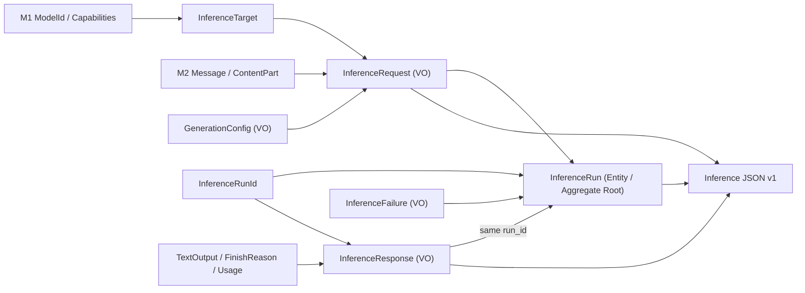
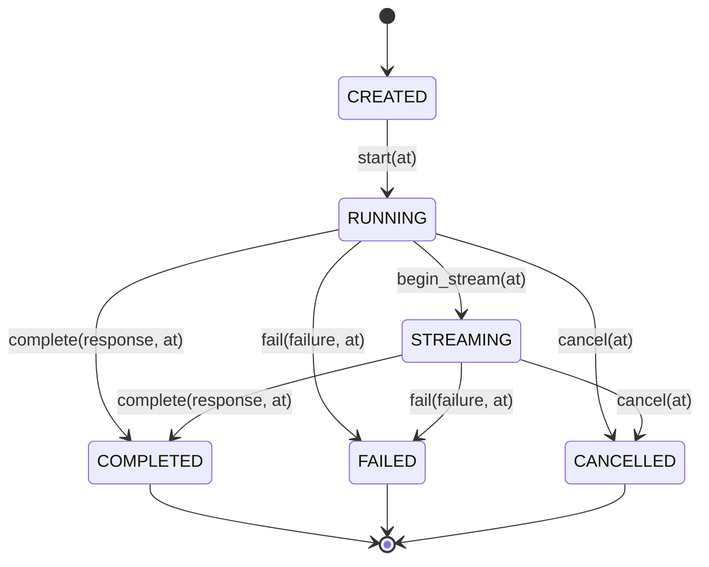

# Phase 3 - Inference Domain Contracts & Boundaries

> Statut : architecture P3-G0 approuvee, primitives P3-G1..G4 integrees et qualifiees.
> Chantier L3.5 : documentation et integration **G5 GO technique avec reserves** sur [main 49cf26e](https://github.com/tawounfouet/pyllmkit/commit/49cf26e830819675a1c4cad9dfd2860fc977f0b6), [PV G5](../quality/P3_G5_GATE_REVIEW.md); M3 et release non qualifies.
> References : ADR-014..021, [Plan Phase 3](../03_PYLLMKIT_PHASE_3_IMPLEMENTATION_PLAN.md), [PV G4](../quality/P3_G4_GATE_REVIEW.md).

## Vue d'ensemble

Ce schema represente **des dependances de donnees de domaine**, pas une architecture d'invocation fournisseur. Aucun noeud n'execute HTTP, ne resolve un deployment, ne planifie un Run, ou ne materialise une image.

## Frontieres DDD et responsabilites

| Domaine | Objet | Nature | Autorite | Garantie |
|---|---|---|---|---|
| M1 | ModelId | Value Object | ADR-001..007 | Identite logique de modele, pas un endpoint |
| M2 | Message / Content | Value Objects | ADR-008..013 | Ordre et doublons des parties conserves |
| L3.1 | ModelTarget / DeploymentTarget / EndpointTarget | Value Objects | ADR-015 | Cible passive, identifiants types distincts |
| L3.1 | GenerationConfig | Value Object | ADR-016 | Floats finis exacts, int exact hors bool, `None` preserve |
| L3.1 | InferenceRequest | Value Object | ADR-014 | Intention immutable, 1..* Message, sans execution |
| L3.1 | GenerationSupportSnapshot / evaluation | Value Objects + fonction pure | ADR-021 A | Support UNKNOWN non transforme en support certain |
| L3.2 | TextOutput / FinishReason / Usage | Value Objects | ADR-017/018 | Pas de prix, pas de valeurs inventees |
| L3.2 | InferenceResponse | Value Object | ADR-014 | Correlation explicite a un RunId |
| L3.3 | InferenceRun | Entity / Aggregate Root | ADR-019 | Identite persistante, snapshots immuables, transitions pures |
| L3.3 | InferenceFailure | Value Object | ADR-019 | Code normalise, pas de native exception |
| L3.4 | Inference JSON v1 | Fonctions pures de serialization | ADR-020 | Enveloppes strictes, six etats valides |

### Invariants de separation

- `InferenceRequest` n'invoque rien. La demande n'a ni `run_id` ni client API.
- `InferenceRun` encapsule un Request et l'identite d'une tentative; deux runs peuvent partager la meme demande sans mutation.
- `InferenceResponse` est independante de l'etat du Run; seul `complete(response, at)` valide la concordance des RunIds.
- `InferenceRun.__eq__` et `__hash__` comparent l'identite `InferenceRunId`, **pas** les snapshots d'etat.
- La transition `begin_stream` est une etiquette d'etat; elle ne cree pas de streaming operationnel.
- `created -> running -> streaming?` puis uniquement `completed | failed | cancelled`. Tous les etats terminaux sont irreversibles, horodatages injectes et timezone-aware.
- Aucune operation de lecture disque, de socket, de credential discovery ou d'import SDK provider n'appartient au domaine `pyllmkit.domain.inference`.

## Diagramme des transitions

## Ports, adaptateurs et API non implementes

Les ports d'execution, fournisseurs, transport HTTP, echanges reseau, model routing, streaming reel, outils, persistence, metriques de cout et bus d'evenements ne font **pas partie du package M3**. Leur place dans l'architecture future n'implique aucune disponibilite actuelle.

Le JSON est un **format de mapping de domaine**. Le parseur de texte JSON, les limites de taille, la detection des cles dupliquees, la securite des URLs et l'authentification relevent de frontieres externes futures.

## Contrats et preuves

- [Inference Request](../concepts/inference-request.md)
- [Inference Response](../concepts/inference-response.md)
- [Inference Run](../concepts/inference-run.md)
- [API unifiee](../api/inference.md)
- [Schema Inference JSON v1](INFERENCE_JSON_SCHEMA_V1.md)
- [Tracabilite P3](../quality/PHASE_3_TRACEABILITY.md)

**Cette architecture de domaine est integree et P3-G5 est qualifie techniquement; M3 et la publication restent des decisions distinctes.**
