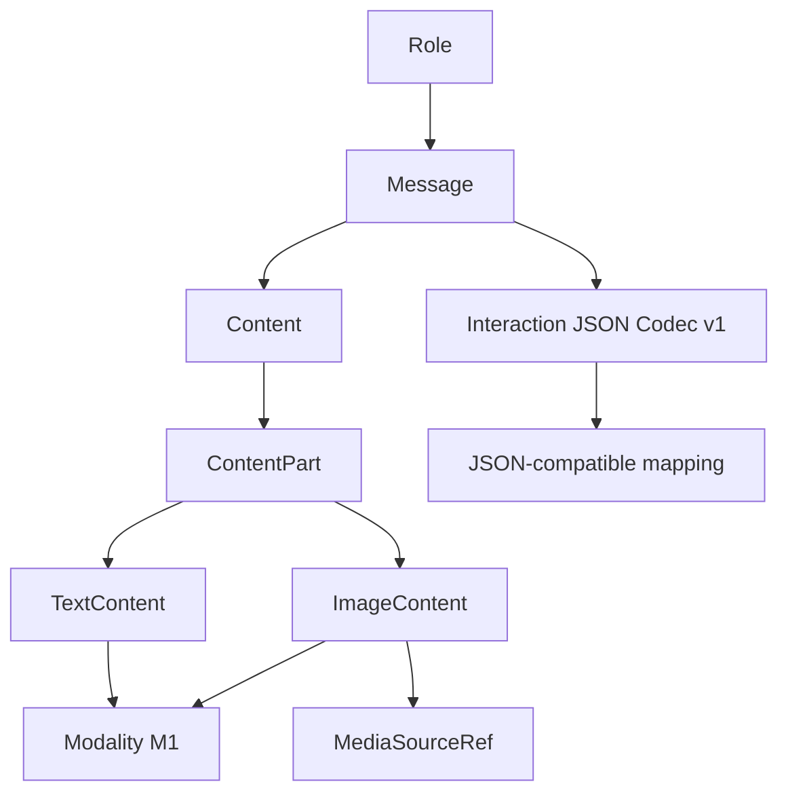

# PyLLMKit - Bilan post-implémentation de la Phase 2

> **Document** : `PYLLMKIT_PHASE_2_POST_IMPLEMENTATION_REVIEW.md`  
> **Nature** : Post-Implementation Review (PIR) / bilan technique, architectural, qualitatif et pédagogique  
> **Projet** : [PyLLMKit](https://github.com/tawounfouet/pyllmkit)  
> **Périmètre** : Phase 2 - Interaction Primitives (`P2-BOOT`, `L2.1`, `L2.2`, `L2.3`, `L2.4`, gates `G0` à `G4`, jalon `M2`)  
> **Date de qualification** : 5 novembre 2026  
> **Date du bilan** : 5 novembre 2026  
> **Statut** : **PHASE 2 CLÔTURÉE - M2 = GO technique**  
> **Version candidate** : `0.1.0a2` - candidate alpha **non publiée**  
> **Branche de référence** : `main`  
> **Commit final vérifié** : [`acd6dfb76d73c260ccca523cf904be44ec249288`](https://github.com/tawounfouet/pyllmkit/commit/acd6dfb76d73c260ccca523cf904be44ec249288)  
> **CI finale après archivage M2** : [GitHub Actions #42016493260](https://github.com/tawounfouet/pyllmkit/actions/runs/42016493260) - **SUCCESS**  
> **Référentiel décisionnel** : ADR-008 à ADR-013, [plan Phase 2](https://github.com/tawounfouet/pyllmkit/blob/main/docs/02_PYLLMKIT_PHASE_2_IMPLEMENTATION_PLAN.md), [procès-verbal M2](https://github.com/tawounfouet/pyllmkit/blob/main/docs/quality/M2_GATE_REVIEW.md)  
> **Positionnement** : Le GO constate la qualification du code et du contrat d'interaction dans le dépôt. Il ne constitue ni une validation de production, ni une autorisation de publication sur PyPI.

---

## 0. Executive summary

La Phase 2 de PyLLMKit avait pour mission de transformer les fondations du Domain Core de M1 en un **modèle d'interaction typé, ordonné, sérialisable et indépendant des fournisseurs LLM**. Elle devait permettre de parler de rôles, de messages et de contenu multimodal **avant** d'introduire des requêtes d'inférence, des clients réseau ou des adaptateurs OpenAI, Anthropic, Google et autres.

**Le résultat attendu est atteint dans le périmètre adopté pour `0.1.0a2`.** Un consommateur Python peut désormais composer un `Message` texte ou texte/image, vérifier les invariants du domaine et effectuer un aller-retour `Message -> dict -> JSON -> dict -> Message`. Ces opérations ne nécessitent aucun SDK fournisseur, aucune clé API et aucun téléchargement de média. Les tests de non-régression de M1 continuent de réussir.

Le projet a été conduit par **11 pull requests fusionnées**, de [#8](https://github.com/tawounfouet/pyllmkit/pull/8) à [#18](https://github.com/tawounfouet/pyllmkit/pull/18), avec des décisions d'architecture explicites, des gates successifs et des vérifications CI sur les commits intégrés.

| Indicateur | Baseline M1 | Sortie M2 vérifiée | Lecture |
|---|---:|---:|---|
| Tests pytest réussis | 137 | **342** | +205 tests dans la suite observée, sans échec final |
| Couverture combinée avec branches | 89 % | **91 %** | +2 points observés ; aucun seuil contractuel inventé |
| Matrice Python | 3.11 / 3.12 / 3.13 | **3/3 SUCCESS** | Compatibilité validée sur les versions testées |
| Contrôles statiques | Ruff, mypy strict | **PASS / PASS** | 26 fichiers source vérifiés par mypy à M2 |
| Packaging | Wheel et sdist | **PASS** | Artefacts `0.1.0a2` construits et testés à l'installation |
| Exemples hors réseau | Phase 1 | **7 scripts** présents | Le scénario de round-trip L2.4 passe en CI |
| Gates de Phase 2 | Sans objet | **G0 à G4 = GO** | M2 formellement qualifié |
| Publication publique | Non effectuée dans M1 | **Non effectuée dans M2** | Aucun tag ni GitHub Release constatés |

**Verdict consolidé : PHASE 2 CLÔTURÉE, M2 = GO technique.** Le logiciel est une bibliothèque de **représentation du domaine des interactions**, pas encore un moteur d'inférence ou un client multi-provider. La prochaine cible est `0.1.0a3 - Inference Primitives`. La dette résiduelle décrite plus loin mérite un suivi explicite, mais aucune non-conformité bloquante n'a été constatée par les contrôles qualifiants de M2.

---

## 1. Expression du besoin et continuité avec la Phase 1

### 1.1. Pourquoi cette phase était nécessaire

M1 avait formalisé ce qu'est un **modèle** et comment décrire ses artefacts, ses capacités et ses modalités. Il ne fournissait pas encore de vocabulaire exécutable pour représenter ce qu'un utilisateur, un système, un développeur ou un outil peut **dire** à ce modèle.

Le risque était de commencer par copier le format `messages` d'un fournisseur et d'en faire, par accident, le format canonique de PyLLMKit. Une telle approche aurait rendu les futures intégrations dépendantes de choix externes : noms de rôles, structure des images, tableaux de contenu, mécanismes de sérialisation et métadonnées propriétaires.

La Phase 2 répond à ce risque en introduisant son propre modèle d'interaction, en conformité avec les principes des documents fondateurs : **Domain First**, **Provider Agnostic by Design**, **Explicit over Implicit**, **Vocabulary Matters**, **Composition over God Objects**, **Interaction is a Domain**, **Multimodality is Native** et **Serialization is Boundary-Aware**.

### 1.2. Objectif effectivement traité

> Construire et qualifier des objets Python immuables représentant les rôles, les messages et les parties de contenu texte/image, avec un codec JSON strict et indépendant des formats fournisseurs, sans dégrader le domaine des modèles déjà qualifié en M1.

### 1.3. Les distinctions qui structurent le résultat

| Distinction | Décision retenue | Conséquence |
|---|---|---|
| `Message != Conversation` | Le Message est utilisable sans agrégat Conversation obligatoire | Pas d'ID ni de persistance imposés |
| `Message != InferenceRequest` | La représentation d'un message précède l'acte d'inférence | `InferenceRequest` est réservé à `0.1.0a3` |
| `Role != provider role string` | Les rôles relèvent d'une taxonomie canonique | Aucun mapping fournisseur implicite dans le domaine |
| `Content != str` | Un Content contient 1..* parties ordonnées | Texte et image peuvent être entrelacés sans aplatissement |
| `ContentPart != Capability` | La modalité décrit la partie, pas l'aptitude effective du modèle | Une `ImageContent` ne garantit pas la vision d'un modèle |
| `MediaSourceRef != media bytes` | La source est une référence passive | Aucun fetch, OCR, stockage ou décodage dans le constructeur |
| `Interaction codec != Model codec` | Versions et schémas séparés | M1 reste indépendant de la sérialisation des messages |
| `Candidate != Release` | `0.1.0a2` est une version de packaging dans le dépôt | Ni tag, ni publication automatique |

---

## 2. Périmètre finalement livré et frontières préservées

### 2.1. Inclus et livré

| Domaine | Livrables intégrés | Validation |
|---|---|---|
| Rôles | `Role` avec `system`, `developer`, `user`, `assistant`, `tool` | G1 |
| Message | `Message(role: Role, content: Content)` | G1, AC-006 |
| Contenu | `ContentPart`, `TextContent`, `Content` | G1 |
| Multimodalité de représentation | `MediaSourceRef`, `ImageContent` | G2, AC-007 |
| Modalités | Réutilisation de `Modality("text")` et `Modality("image")` | G1/G2 |
| Sérialisation | `INTERACTION_SCHEMA_VERSION = 1`, `message_to_dict`, `message_from_dict` | G3 |
| Qualité | Tests positifs/négatifs, architecture, régression, exemples, CI, packaging | G3/G4 |
| Gouvernance | ADR-008..013, gates G0..G4, dossier M2 | M2 |

### 2.2. Explicitement différé

| Sujet | Statut au terme de M2 | Direction documentaire |
|---|---|---|
| `Conversation` agrégat et persistance | Non implémenté, optionnel | Seulement si un cas d'usage justifie son cycle de vie |
| `AudioContent`, `VideoContent`, `DocumentContent` | Non implémentés | Extensions futures à contrats précis (ADR-013) |
| `ToolCallContent`, `ToolResultContent`, exécution d'outils | Non implémentés | `0.1.0a4` selon la roadmap |
| `InferenceRequest`, `InferenceResponse`, `InferenceRun`, `GenerationConfig` | Non implémentés | `0.1.0a3` |
| Streaming et événements d'inférence | Non implémentés | Incréments bêta ultérieurs |
| Registry et recherche de modèles | Non implémentés | Évolution ultérieure |
| Provider adapters, routing, appels réseau | Non implémentés dans le cœur | Couche d'intégration future |
| Résolution des capacités effectives | Non implémentée | Service dédié ultérieur |
| Téléchargement d'images, contrôle MIME, OCR, transcodage | Non implémentés | Frontières d'application/adapter et politique de sécurité |

**Interprétation :** ne pas livrer ces objets n'est pas un échec de M2. Il s'agit d'une limitation **intentionnelle et documentée**. La réussite de cette phase est celle d'un **contrat de représentation**, non d'un moteur opérationnel.

---

## 3. Trajectoire de réalisation et gouvernance GitHub

### 3.1. Découpage et ordre réel

La chaîne de développement a été conduite selon une dépendance technique explicite : décisions, construction des parties de contenu, messages, images, codec, qualification puis archivage.

```text
M1 - Domain Foundations Qualified
 |
 v
P2-BOOT - Contrats Interaction + ADR-008..013
 |
 v
L2.2 - ContentPart, TextContent, Content
 |
 v
L2.1 - Role, Message, AC-006
 |
 v
L2.3 - MediaSourceRef, ImageContent, AC-007
 |
 v
L2.4 - Codec Interaction JSON v1, round-trips, tests, packaging
 |
 v
G3 - Quality Ready
 |
 v
G4 - Integration Ready
 |
 v
M2 - Interaction Foundations Qualified : GO technique
 |
 +-- 0.1.0a2 : candidat construit, non publié
 |
 +-- 0.1.0a3 : prochaine étape, Inference Primitives
```

L'ordre réel **L2.2 puis L2.1** est cohérent avec la dépendance : un `Message` ne peut pas être construit correctement avant la définition du `Content` auquel il fait référence. Le numéro du lot désigne son thème fonctionnel, pas nécessairement son ordre de fusion.

### 3.2. Inventaire des 11 pull requests de Phase 2

| PR | Livraison | Contribution principale |
|---|---|---|
| [#8](https://github.com/tawounfouet/pyllmkit/pull/8) | P2-BOOT | Contrats d'architecture et décisions ADR-008..013 |
| [#9](https://github.com/tawounfouet/pyllmkit/pull/9) | Documentation G0 | Archivage du GO G0 et registre ADR |
| [#10](https://github.com/tawounfouet/pyllmkit/pull/10) | Synchronisation G0 | Roadmap et traçabilité |
| [#11](https://github.com/tawounfouet/pyllmkit/pull/11) | L2.2 | `ContentPart`, `TextContent`, `Content` |
| [#12](https://github.com/tawounfouet/pyllmkit/pull/12) | L2.1 | `Role`, `Message`, AC-006 |
| [#13](https://github.com/tawounfouet/pyllmkit/pull/13) | Documentation G1 | Clôture Content & Message Ready |
| [#14](https://github.com/tawounfouet/pyllmkit/pull/14) | L2.3 | `MediaSourceRef`, `ImageContent`, AC-007 |
| [#15](https://github.com/tawounfouet/pyllmkit/pull/15) | Documentation G2 | Clôture Multimodal Content Ready |
| [#16](https://github.com/tawounfouet/pyllmkit/pull/16) | L2.4 | Codec JSON v1, régression, qualité, candidat `0.1.0a2` |
| [#17](https://github.com/tawounfouet/pyllmkit/pull/17) | Documentation G3/G4 | Dossier qualité, API, schéma, README, roadmap |
| [#18](https://github.com/tawounfouet/pyllmkit/pull/18) | Qualification M2 | Procès-verbal M2, décision GO, archivage final |

**Constat :** ces 11 PR sont toutes fusionnées. L'ensemble correspond à quatre PR de fonctionnalités (`#11`, `#12`, `#14`, `#16`), une PR d'architecture (`#8`) et six PR de consolidation documentaire (`#9`, `#10`, `#13`, `#15`, `#17`, `#18`). Une PR fusionnée et des checks verts prouvent les vérifications conduites, pas une approbation indépendante par un tiers.

### 3.3. Références immuables et gates

| Jalon | Commit `main` qualifié | CI | Statut |
|---|---|---|---|
| G0 - Architecture Ready | `0eb2d54b93eaa9375237674916504d5ab45ab373` (archive G0) | [#42006193308](https://github.com/tawounfouet/pyllmkit/actions/runs/42006193308) | GO |
| G1 - Content & Message Ready | `1fd7a476f0aa0b0040c0749ae36236fa24d6f8e6` | [#42008750610](https://github.com/tawounfouet/pyllmkit/actions/runs/42008750610) | GO |
| G2 - Multimodal Ready | `8e4d8c1df998d17e20e50a79b5c6904fe5de0616` | [#42011868937](https://github.com/tawounfouet/pyllmkit/actions/runs/42011868937) | GO |
| G3 - Quality Ready | `fb4760aa890dceb8c08b16738500b5b28574e60b` | [#42015194077](https://github.com/tawounfouet/pyllmkit/actions/runs/42015194077) | GO |
| G4 - Integration Ready | `560d3a46c74cecebdf6a55301b2b8ca4e34331d4` | [#42015825424](https://github.com/tawounfouet/pyllmkit/actions/runs/42015825424) | GO |
| M2 - Décision technique et archive | **`acd6dfb76d73c260ccca523cf904be44ec249288`** | [**#42016493260**](https://github.com/tawounfouet/pyllmkit/actions/runs/42016493260) | **GO** |

Les chiffres de test et de couverture reportés dans ce bilan portent sur les étapes explicitement qualifiées, et non sur un état local non attesté.

---

## 4. P2-BOOT - Architecture et gouvernance des décisions

### 4.1. Livrables

P2-BOOT a introduit le contrat de domaine Interaction, le plan d'implémentation, les garde-fous d'import et six nouvelles ADR. Le projet ne commence pas les objets Python à partir de la forme d'une réponse d'API fournisseur : il en déduit d'abord les invariants métier.

### 4.2. Évaluation des ADR-008 à ADR-013

| ADR | Décision de conception | Réalisation effective | Évaluation |
|---|---|---|---|
| [ADR-008](https://github.com/tawounfouet/pyllmkit/blob/main/docs/adr/ADR-008-role-taxonomy.md) | Taxonomie canonique des rôles | Cinq rôles via `Role` | Appliquée |
| [ADR-009](https://github.com/tawounfouet/pyllmkit/blob/main/docs/adr/ADR-009-message-conversation-ownership.md) | `Message` autonome, `Conversation` facultative | `Message` sans identifiant ni agrégat requis | Appliquée |
| [ADR-010](https://github.com/tawounfouet/pyllmkit/blob/main/docs/adr/ADR-010-content-polymorphism-and-order.md) | Parties polymorphes, contenus immuables et ordonnés | `ContentPart`, `TextContent`, `Content`, `ImageContent` | Appliquée |
| [ADR-011](https://github.com/tawounfouet/pyllmkit/blob/main/docs/adr/ADR-011-media-source-safety.md) | Références média passives avec validation syntaxique | `MediaSourceRef(kind, value)` | Appliquée dans sa frontière |
| [ADR-012](https://github.com/tawounfouet/pyllmkit/blob/main/docs/adr/ADR-012-interaction-json-codec.md) | Codec JSON versionné indépendant | `message_to_dict`, `message_from_dict`, schéma v1 | Appliquée |
| [ADR-013](https://github.com/tawounfouet/pyllmkit/blob/main/docs/adr/ADR-013-multimodal-extension-policy.md) | Étendre sans simuler un support non livré | Texte/image pris en charge ; autres modalités différées | Appliquée |

**Valeur architecturale :** le contrat précède l'implémentation ; les décisions sont justifiables, traçables et peuvent être réfutées par des tests. Les ADR sont des décisions de projet acceptées par le propriétaire. Aucun audit architectural externe indépendant n'est documenté.

**Point documentaire résiduel :** au 5 novembre 2026, certains en-têtes des ADR-010 à ADR-013 indiquent encore que l'implémentation ou M2 est « pending ». Leur **statut de décision ACCEPTED** reste correct, mais cette phrase historique doit être contextualisée ou mise à jour à la lumière de M2 GO. Ne pas interpréter cette formulation comme une annulation du GO final.

---

## 5. L2.2 - Content Domain

### 5.1. Objets introduits

- `ContentPart` : base abstraite définissant `kind` et `modality`.
- `TextContent(text: str)` : partie texte immutable (`frozen=True`, `slots=True`).
- `Content(parts: tuple[ContentPart, ...])` : conteneur immuable non vide et strictement typé.

### 5.2. Invariants matérialisés

1. `Content` requiert un **tuple non vide** : la liste et la chaîne ne sont pas converties silencieusement.
2. Chacune des parties doit implémenter `ContentPart`.
3. `TextContent.text` doit être une véritable chaîne ; `None` et les types non textuels sont rejetés.
4. La chaîne vide `""` est autorisée comme valeur textuelle intentionnelle. Elle ne doit pas être confondue avec un `Content` sans partie.
5. L'ordre et les parties identiques répétées sont conservés : pas de tri, dédoublonnage ni fusion implicite.
6. La modalité d'une partie est **descriptive**, et non une promesse de prise en charge par un modèle.

### 5.3. Apport au design

**DDD - Value Object** : la représentation d'un contenu est immuable et possède une égalité par valeur. **Composition** : un message agrège un `Content`, qui compose plusieurs `ContentPart`. **Polymorphism** : les parties concrètes répondent au même contrat sans perdre leur type particulier.

**Évaluation :** les abstractions sont suffisamment générales pour la composition texte/image, mais restent volontairement étroites sur les types réellement pris en charge par le codec v1.

---

## 6. L2.1 - Message Domain

### 6.1. Objets introduits

- `Role` : enum canonique contenant exactement `SYSTEM`, `DEVELOPER`, `USER`, `ASSISTANT` et `TOOL`.
- `Message(role: Role, content: Content)` : objet immutable, validé à l'exécution, sans ID imposé.

### 6.2. Décisions concrètes

**Un rôle n'est pas un alias libre.** Un appel explicite à `Role("user")` est possible ; transmettre une chaîne brute à `Message` n'entraîne pas de conversion implicite. Les valeurs inconnues échouent plutôt que d'être ramenées artificiellement à `USER`.

**Un message est indépendant d'une conversation.** Le domaine peut représenter un échange élémentaire sans avoir défini de conversation persistée, de session réseau, de base de données ou d'orchestrateur.

**Le rôle `TOOL` n'est pas un outil.** Il désigne seulement un locuteur sémantique. Aucun contrat d'exécution de fonction, d'appel d'outil ou de résultat structuré n'est ajouté par ce rôle.

### 6.3. Résultat

Le scénario **AC-006** de message texte indépendant d'un fournisseur est couvert par un test d'acceptation dédié, puis par un round-trip JSON ajouté au lot L2.4.

---

## 7. L2.3 - Multimodal Content

### 7.1. Objets introduits

`MediaSourceRef(kind: str, value: str)` est une référence immutable à une source. Ses deux discriminants sont :

- `uri` : URL absolue HTTP(S), avec hôte syntaxiquement valide. L'objet stocke la chaîne intacte.
- `asset` : identifiant opaque non blanc. L'objet ne suppose ni stockage ni système de fichiers.

`ImageContent(source: MediaSourceRef)` est une partie immutable dont `kind == "image"` et `modality == Modality("image")`.

### 7.2. Propriété métier vérifiée

Une composition telle que `TextContent -> ImageContent -> TextContent` conserve son **ordre exact**, ses valeurs et ses duplications. Le test **AC-007** démontre cette représentation sans transport fournisseur. Les cas tests L2.4 démontrent ensuite sa reconstruction après passage par JSON.

### 7.3. Frontière de sécurité

**Validation syntaxique ne signifie pas autorisation réseau.** Un hôte syntaxiquement valide peut être privé, interne, local ou soumis à une politique d'accès. Le domaine n'effectue ni DNS, ni HTTP GET/HEAD, ni ouverture de fichier, ni OCR, ni décodage ou téléchargement.

Les schémas `file:`, `data:`, les chemins locaux et les octets intégrés sont exclus du contrat v1. Le `repr` de `MediaSourceRef` masque sa valeur ; ses erreurs de validation n'incluent pas la chaîne source.

**Limite à conserver** : le codec JSON **doit** émettre les valeurs complètes des URI pour garantir un round-trip exact. Une application qui journalise directement ce mapping peut donc exposer des jetons ou identifiants présents dans une URL. Le masquage dans `repr` ne garantit pas le masquage des données sérialisées.

---

## 8. L2.4 - Codec JSON, tests et qualification

### 8.1. Architecture du codec

L2.4 a créé le module autonome :

`pyllmkit.domain.interactions.serialization`

Son API principale est :

```python
INTERACTION_SCHEMA_VERSION = 1

def message_to_dict(message: Message) -> dict[str, object]: ...
def message_from_dict(payload: Mapping[str, object]) -> Message: ...
```

La version du schéma Interaction ne réutilise pas le `SCHEMA_VERSION` du codec Model de M1. Deux schémas peuvent porter la valeur numérique `1` tout en étant **des contrats distincts**.

### 8.2. Schéma canonique réellement implémenté

```json
{
  "schema_version": 1,
  "object_type": "message",
  "role": "user",
  "content": {
    "parts": [
      {"kind": "text", "text": "Regarde cette image : "},
      {
        "kind": "image",
        "source": {"kind": "asset", "value": "image-123"}
      },
      {"kind": "text", "text": "Que vois-tu ?"}
    ]
  }
}
```

### 8.3. Règles de lecture/écriture

- `schema_version` est **l'entier** `1`, pas `"1"`, `1.0` ou `true`.
- `object_type` vaut exactement `"message"`.
- `role` est l'une des cinq valeurs canoniques.
- `content.parts` est une liste JSON non vide dont l'ordre est conservé.
- `kind == "text"` requiert le champ texte ; `kind == "image"` requiert `source`.
- Les références d'image exigent exclusivement `kind` et `value` et sont revalidées.
- Les champs additionnels, absents, mal typés ou inconnus provoquent `DomainValidationError`.
- Les contenus sous-classés mais non enregistrés dans le contrat de codec ne sont pas sérialisés silencieusement.
- Aucun payload natif fournisseur n'est reconnu comme un format de domaine implicite.

### 8.4. Ce que garantit et ne garantit pas le round-trip

La suite qualifie l'égalité des objets Domain avant/après un aller-retour `dict -> JSON -> dict`, y compris pour les textes Unicode, espaces, lignes vides, parties répétées, rôles et références `uri`/`asset`.

Deux frontières restent distinctes :

1. `message_from_dict` prend une **structure Python déjà parsée**, pas une chaîne de caractères JSON.
2. `json.loads` standard peut écraser une clé JSON dupliquée avant que le codec ne voie le mapping. Si un protocole exige le rejet des clés dupliquées, cette exigence doit être traitée **au niveau du parseur/transport**, par exemple au moyen d'un parseur strict.

**Évaluation :** excellente discipline de schéma pour un alpha ciblé, sans prétendre offrir déjà une politique générale de migrations de versions ou une compatibilité avec les payloads fournisseurs.

---

## 9. Architecture livrée et règles de dépendance

### 9.1. Vue structurée du domaine



Le diagramme représente les **relations conceptuelles** : il n'implique pas que `Role` soit une entité propriétaire de `Message`, ni que JSON soit un agrégat DDD.

### 9.2. Structure de source constatée sur `main`

```text
src/pyllmkit/domain/
  __init__.py
  errors.py
  modalities/
  models/
  capabilities/
  interactions/
    __init__.py
    roles.py
    message.py
    parts.py
    text.py
    content.py
    media.py
    image.py
    serialization.py
```

Les neuf fichiers sous `interactions/` sont présents sur le commit final. Ils utilisent les primitives transverses du Domain Core (erreurs et modalité) et ne dépendent pas du module Model pour serialiser les messages.

### 9.3. Relations avec les principes de conception

| Concept nommé | Expression réelle dans PyLLMKit | Bénéfice | Prudence |
|---|---|---|---|
| **DDD - Ubiquitous Language** | Role, Message, Content, ImageContent | Sémantique indépendante des SDK | Ne pas confondre avec l'API d'un provider |
| **DDD - Value Object** | Objets `frozen` et validés | Egalité, stabilité et reconstruction | Ne couvre pas un cycle de persistance |
| **Composition** | `Message -> Content -> parts` | Flexibilité de la structure | Pas de contenu vide permis |
| **Polymorphism / OCP** | `ContentPart` et sous-types | Extension possible | Codec strict sur types explicitement admis |
| **SoC / SRP** | Codec séparé des VOs | Responsabilités lisibles | Un codec ne résout pas les politiques transport |
| **Hexagonal / Clean Architecture** | Domain Core sans SDK et sans HTTP | Direction des dépendances préservée | Les adapters restent à bâtir |
| **Explicit over Implicit** | Rejets des rôles, champs et sources non connus | Réduction de perte silencieuse | Coût de migration à prévoir |
| **KISS / YAGNI** | Pas de faux objets audio ou tools | Scope démontrable | Des évolutions réelles seront nécessaires |
| **Contract & Regression Testing** | Tests AC, codec, fitness, CI | Vérification reproductible | Ne constitue pas une preuve de sécurité exhaustive |

---

## 10. Qualification qualité et non-régression

### 10.1. Progression observée de la suite

| Baseline intégrée | Tests réussis | Couverture combinée (branches incluses) | Explication |
|---|---:|---:|---|
| M1 - Phase 1 | 137 | 89 % | Fondations Model/Capability/Modality |
| G1 - Message et Content | 204 | 90 % | TextContent, Content, Role, Message |
| G2 - Image | 252 | 90 % | MediaSourceRef, ImageContent, AC-007 |
| G3 - Codec et qualité | 342 | 91 % | Round-trip, erreurs, extension refusée, packaging |
| M2 - `main` final | **342** | **91 %** | Contrat intégral et archivage sans régression |

Les pourcentages sont les **mesures publiées dans les journaux CI**, avec activation de la couverture des branches. Ils ne doivent pas être convertis rétroactivement en un objectif de couverture contractuel.

### 10.2. Contrôles sur le SHA final

| Contrôle | Résultat observé sur le commit final |
|---|---|
| GitHub Actions | **SUCCESS** - [run #42016493260](https://github.com/tawounfouet/pyllmkit/actions/runs/42016493260) |
| Python | **3.11 / 3.12 / 3.13 : 3/3 SUCCESS** |
| pytest | **342 passed** |
| Couverture | **91 %**, branches incluses |
| Ruff | **PASS** |
| mypy strict | **PASS sur 26 fichiers source** |
| Scripts | `examples/01` à `examples/07`, scénario L2.4 exécuté |
| Build wheel | `pyllmkit-0.1.0a2-py3-none-any.whl` construit |
| Build sdist | `pyllmkit-0.1.0a2.tar.gz` construit |
| Installation isolée | Smoke tests pour wheel et sdist **PASS** |
| Tests Model/Artifact de M1 | Inclus dans la suite complète, **PASS** |

**Limite de la preuve :** la CI valide les systèmes, versions et scénarios qui y sont configurés. Elle n'établit pas de preuve exhaustive de sécurité, de performance, de comportement réseau réel ou de compatibilité universelle de toutes les versions Python futures.

### 10.3. Organisation des tests

```text
tests/
  acceptance/
    test_ac_006_text_message.py
    test_ac_007_multimodal_message.py
    test_ac_006_007_roundtrip.py
  serialization/
    test_interaction_codec.py
    test_interaction_codec_extension.py
  unit/domain/interactions/
    test_content.py
    test_image_content.py
    test_media_source_ref.py
    test_message.py
    test_role.py
    test_text_content.py
  architecture/
    test_p2_boot_contracts.py
```

Cette structure est complémentaire des tests M1 conservés. Elle sépare la **validité d'un VO**, le **contrat de sérialisation**, le **cas d'acceptation métier** et les **frontières d'import**.

### 10.4. Retouches effectuées pendant l'intégration

Les journaux des PR révèlent des erreurs de lint liées au tri des imports, puis des erreurs mypy sur des conversions devenues superflues dans le codec. Ces erreurs ont été corrigées **avant** les fusions qualifiées. Elles ne constituent pas des régressions présentes dans le commit final, mais signalent un axe d'optimisation : vérifier Ruff et mypy localement ou dans une PR de travail avant d'engager de multiples runs CI.

---

## 11. Traçabilité des exigences et des invariants

| Source / critère | Contrat réalisé | Preuve principale | Verdict borné |
|---|---|---|---|
| **AC-006** | Message texte, rôle canonique, JSON round-trip | `test_ac_006_text_message.py`, `test_ac_006_007_roundtrip.py` | **PASS** |
| **AC-007** | Message texte/image/texte ordonné, JSON round-trip | `test_ac_007_multimodal_message.py`, `test_ac_006_007_roundtrip.py` | **PASS** |
| `INT-001` | `Message` indépendant d'une `Conversation` | `test_message.py` | PASS pour le périmètre adopté |
| `INT-002` | Ordre des messages non altéré par un objet de domaine | `Message` autonome ; pas de `Conversation` implémentée | Partiellement applicable ; pas de collection de messages à qualifier |
| `INT-003` | Ordre des `ContentPart` conservé | `test_content.py`, tests codec multimodal | PASS |
| `INT-004` | Rôle valide obligatoire | `test_role.py`, `test_message.py` | PASS |
| `INT-005` | Message contenant un `Content` non vide | `test_content.py`, `test_message.py` | PASS |
| `INT-006` | Mapping des rôles sans modification silencieuse | Taxonomie et erreurs d'entrée ; adapters absents | PASS côté domaine, mapping réel différé |
| `INT-007` | Pas de payload natif provider dans le cœur | API canonique et contrôles d'import | PASS dans la frontière testée |
| `INT-008` | Texte non nul ; chaîne vide autorisée | `test_text_content.py` | PASS |
| `INT-009` | Source image explicite et valide | `test_media_source_ref.py`, `test_image_content.py` | PASS pour `uri` et `asset` passifs |
| `INT-010` | Format audio si nécessaire | Pas de `AudioContent` proposé | **Différé** par ADR-013 |
| `INT-011` | Document distinct du texte | Pas de `DocumentContent` proposé | **Différé** par ADR-013 |
| `MOD-003` | Modalité de partie explicite | Tests TextContent et ImageContent | PASS |
| `MOD-005` | Aucune conversion multimodale implicite | Construction passive, codec sans I/O | PASS dans la frontière testée |
| Codec `Interaction v1` | Version indépendante, strictness, ordre/valeurs | `test_interaction_codec.py`, `test_interaction_codec_extension.py` | PASS |
| Régression `Model v1` | Aucun changement du codec Model/Artifact | Suite M1 inchangée, CI finale | PASS |

**Précision importante :** l'existence d'un test de rôle, d'un test de Message ou d'un garde-fou d'import ne vaut pas vérification du comportement d'un provider non implémenté. Les lignes `INT-002` et `INT-006` ont donc une lecture volontairement limitée aux contrats disponibles.

---

## 12. Revue critique des choix d'architecture

### 12.1. Choix réussis

**1. Refuser la normalisation par un SDK.** Le domaine conserve un vocabulaire propre, avant toute tentative d'intégration fournisseur. C'est le principal acquis architectural de M2.

**2. Rendre l'ordre explicite.** Une séquence texte/image/texte n'est pas équivalente à un simple texte ou à un sac de pièces. L'ordre est porté par un tuple immuable et prouvé par les tests.

**3. Préserver la distinction entre représentation et capacité.** La présence d'une partie image n'autorise aucune conclusion sur l'aptitude effective d'un modèle à la traiter.

**4. Matérialiser la frontière de l'infrastructure.** Les sources sont passives, ce qui permet d'avoir un contrat image sans le lier prématurément à HTTP, à une base d'assets ou à un SDK de cloud.

**5. Refuser les valeurs inconnues dans le schéma v1.** Les erreurs explicites évitent que l'ajout accidentel de champs à un payload soit traité comme une transformation sans perte.

**6. Conserver les anciennes garanties.** Le nouveau codec n'est pas greffé sur le format JSON du domaine Model. Cette séparation réduit le risque d'altérer des snapshots déjà créés en M1.

### 12.2. Compromis à garder conscients

**Abstraction ouverte, codec fermé.** `ContentPart` peut théoriquement recevoir de nouveaux sous-types, mais le codec accepte uniquement les types concrets explicitement prévus par ADR-012. Ce n'est pas une contradiction : c'est la distinction entre *extensibilité du modèle mémoire* et *stabilité du schéma persisté*. Toute nouvelle partie exige une décision de versionnement.

**Immutabilité forte, parsing strict.** L'interdiction des conversions implicites favorise les invariants, mais oblige les futurs adapters à faire un mapping intentionnel, contrôlé et couvert par tests de contrat.

**Références URI intégrales.** La préservation exacte des sources aide la sérialisation et expose un risque documentaire ou de logs si elles contiennent des paramètres sensibles. La responsabilité se déplace légitimement vers l'application.

**Aucun Conversation agrégat.** Le périmètre reste simple et prouvable. En contrepartie, la gestion de l'historique, des sessions et des threads n'a pas encore de cycle de vie de domaine établi.

### 12.3. Anti-patterns évités

- **God Message** : un seul objet accumulant provider, transport, paramètres, historique et résultats.
- **Primitive Obsession** : un simple `str` ou une liste de dictionnaires non typés en guise de contrat universel.
- **Silent Coercion** : conversion de chaînes inconnues en rôles ou de contenus inconnus en texte.
- **Leaky Abstraction** : introduction de schémas propres à OpenAI ou Anthropic dans le domaine.
- **Premature Generalization** : classes fictives `AudioContent`, `DocumentContent` ou outils sans invariants qualifiés.
- **Infrastructure Coupling** : chargement des images pendant la création d'un Value Object.

---

## 13. Écarts, risques résiduels et dette technique

Les entrées suivantes distinguent les **faits vérifiés** dans le dépôt des **actions recommandées**. Ce sont des priorités proposées pour le suivi post-M2, et non des conditions de GO rétroactivement ajoutées.

| ID | Constat et base de preuve | Risque / portée | Priorité proposée | Action recommandée |
|---|---|---|---|---|
| **PIR2-01** | Les ADR-010..013 conservent un en-tête indiquant « Implementation and M2 qualification remain pending » malgré M2 GO | Incohérence documentaire lors d'une lecture isolée | **P1 docs** | Ajouter une note historique ou un lien explicite vers `M2_GATE_REVIEW.md`, sans réécrire la décision originale |
| **PIR2-02** | Le bloc `Domain example` du `README.md` contient encore des séquences littérales `\n` dans la ligne `from pyllmkit.domain import (` | Snippet potentiellement invalide au copier-coller | **P1 docs** | Corriger le bloc et ajouter un smoke test des exemples de README |
| **PIR2-03** | La signature publique `message_from_dict(payload: Mapping[str, object])` annonce `Mapping`, mais `_object` exige `isinstance(..., dict)` | Contrat de typage plus large que le comportement runtime | **P1 technique** | Décider : accepter tout Mapping immuable ou restreindre l'annotation à un dict ; tester le cas `MappingProxyType` |
| **PIR2-04** | La lecture de JSON texte utilise en exemple `json.loads` standard, lequel peut écraser les clés dupliquées | Confusion possible entre parsing JSON et validation de mappings | **P1 avant exposition HTTP** | Documenter et tester un parseur strict à la future frontière transport si la politique le requiert |
| **PIR2-05** | Les sources `uri` subissent une validation syntaxique uniquement ; hôtes privés/loopback possibles | Risque SSRF si un futur adapter les déréférence sans contrôle | **P0 avant fetch réseau** | Définir politique d'URL/redirects/IP/DNS/tailles/MIME et tests adversariaux côté adapters |
| **PIR2-06** | `message_to_dict` conserve volontairement les URI complètes | Risque de fuite de query tokens dans logs ou traces | **P0 avant observabilité** | Politique de redaction des payloads et logs, sans modifier la réversibilité du codec |
| **PIR2-07** | `main` est signalé non protégé (`protected: false`) | CI verte sans garantie de revue/contrôle à chaque future intégration | **P1 gouvernance** | Proposer protections/rulesets et checks requis avant une publication publique |
| **PIR2-08** | Couverture de 91 % observée, sans seuil formel | Absence de seuil de non-régression adopté | **P2 qualité** | Définir des seuils ciblés par modules critiques et comparer à une baseline contrôlée |
| **PIR2-09** | Les documents fondateurs `00` à `09` sont dans le corpus du projet, mais non exhaustivement suivis sous ces noms dans GitHub | Source de vérité répartie, divergences possibles | **P2 docs** | Index canonique des sources, décisions de synchronisation et liens stables |
| **PIR2-10** | Interaction JSON v1 rejette tous les types de partie non approuvés | Future extension potentiellement cassante pour les lecteurs | **P1 avant nouveau type** | ADR de version v2, politique de migration et tests de compatibilité |
| **PIR2-11** | Les supports audio, vidéo, documents, tools, inference et adapters n'existent pas encore | Limite produit fonctionnelle, mais hors scope M2 | **Roadmap** | Conserver un backlog par version et éviter toute revendication prématurée |
| **PIR2-12** | Les infographies représentatives ne sont pas des spécifications de schéma | Une illustration peut simplifier ou altérer les noms/valeurs JSON | **P2 communication** | Générer les visuels à partir d'exemples exécutables ou afficher « schéma illustratif » |
| **PIR2-13** | La version `0.1.0a2` est construite mais non publiée ; aucune release GitHub ni aucun tag n'ont été constatés | Risque de confondre milestone et distribution | **P1 avant release** | Release checklist explicite, provenance, licence, ownership et décision séparée |

**Définition des priorités :** `P0 avant fetch réseau` est une condition de travail future avant de donner à un adapter la permission d'accéder aux URI ; elle ne signifie pas qu'un fetch réseau dangereux existe aujourd'hui dans PyLLMKit. `P1` désigne un correctif conseillé à court terme. `P2` désigne une amélioration ou dette planifiable. Ces priorités représentent **l'analyse du présent PIR**.

### 13.1. Constat de conformité bloquante au regard de M2

Les contrôles du jalon n'ont mis en évidence **aucune non-conformité bloquante persistante** sur le SHA final : tous les checks de CI requis sont verts, les critères AC-006/AC-007 passent, et les PR qualifiantes sont intégrées.

Cette conclusion est limitée au **périmètre de M2 et à son dispositif de tests**. Elle ne démontre pas la sécurité générale de futurs connecteurs réseau ni la complétude d'un framework LLM de production.

---

## 14. Enseignements - Software Design & Learning

### 14.1. Ce qui a bien fonctionné

1. **Partir des invariants plutôt que du code fournisseur.** Les ADR ont défini la sémantique métier, puis les tests ont protégé cette sémantique.
2. **Commencer par les unités les plus fondamentales.** Le Content Domain a été intégré avant le Message Domain malgré l'ordre nominal des lots. C'est une application pratique de la Dependency Rule.
3. **Distinguer représentation et action.** Représenter une image ne doit pas provoquer un effet de bord ; représenter le rôle `TOOL` ne doit pas lancer un outil.
4. **Modéliser la multimodalité sans l'industrialiser trop tôt.** Le support d'une référence média passive permet de tester le contrat sans résoudre prématurément les sujets réseau et stockage.
5. **Écrire un codec dédié au bounded context.** Cette décision évite de réutiliser artificiellement le schéma Model et limite les impacts de changement.
6. **Garder l'échec explicite.** Les cas négatifs valident le comportement de rejet, pas seulement les scénarios heureux.
7. **Qualifier les commits intégrés, pas les promesses.** Chaque gate a été rattaché à des checks CI exécutés sur un SHA identifiable.
8. **Dissocier livraison logicielle, GO technique et publication.** Le package a été construit sans être présenté comme une release déjà disponible sur PyPI.

### 14.2. Ce qu'il faudrait améliorer

- **Boucle de feedback plus courte.** Les retouches Ruff/mypy ont entraîné plusieurs runs CI. Ajouter une commande locale reproductible ou des hooks de pre-commit accélérerait les changements sans réduire la rigueur.
- **Documentation exécutable.** Les scripts `examples/` passent, mais cela ne suffit pas à garantir la validité de tous les blocs de README. Tester automatiquement les snippets canoniques.
- **Traçabilité documentaire moins réactive.** Les archives de gates font plusieurs PR dédiées. Conserver cette preuve est utile, mais un tableau unique d'état courant, généré ou contrôlé, réduirait les mentions historiques obsolètes.
- **Couverture de contrats plus fine.** Le chiffre global 91 % est utile, mais une cartographie du risque par classe et branche critique sera plus informative à mesure que le produit grandit.
- **Gouvernance GitHub plus robuste.** Des PR ont été utilisées systématiquement, mais les règles de protection de `main` restent un objectif distinct.
- **Clarté du passage aux adapters.** Avant P3, préciser les frontières entre API publique, use cases, ports, policy et future exécution d'inférence.

### 14.3. Patterns à retenir pour l'usine Py*Kit

| Pattern de méthode | Application générique |
|---|---|
| **ADR -> invariants -> type -> tests -> CI -> gate** | Évite les implémentations opportunistes difficiles à stabiliser |
| **Value Object + validation runtime** | Favorise la fiabilité des contrats d'entrée |
| **Codec versionné par bounded context** | Préserve l'indépendance des schémas métier |
| **Tests d'acceptation et tests négatifs** | Rend explicite le comportement requis et les rejets |
| **Evidence-first gate** | Interdit de déclarer un GO sans preuve sur le commit intégré |
| **Candidate != publication** | Évite de confondre avancement technique et opération de distribution |

Ces patterns sont des **enseignements transposables**, pas une affirmation que tous les autres projets Py*Kit possèdent déjà les mêmes contrôles.

---

## 15. Maturité à la sortie de Phase 2

| Dimension | État observé | Ce que cela signifie |
|---|---|---|
| Vocabulaire de domaine Interaction | **Implémenté** | Role/Message/Content et parties texte/image disponibles |
| Typage et invariants | **Qualifiés** | Validation stricte et VOs immuables testés |
| Sérialisation | **Qualifiée pour Interaction v1** | Mapping strict et round-trip, indépendamment de Model v1 |
| Compatibilité avec M1 | **Vérifiée par régression** | Tests anciens et nouvelles suites verts |
| Qualité CI | **Opérationnelle** | 3 versions Python, Ruff, mypy strict, pytest, coverage |
| Packaging installable | **Validé** | Wheel et sdist candidats construits/testés |
| Documentation d'architecture | **Disponible** | ADR, contrat, API, traceabilité et M2 report |
| Conversation persistante | **Non fournie** | Agrégat et repository éventuels différés |
| Inference domain | **Non fourni** | Requêtes, réponses, exécution à concevoir en a3 |
| Provider adapters | **Non fournis** | Aucune invocation distante multi-provider attestée |
| Sécurité transport média | **Non qualifiée** | Contrôles à construire aux frontières futures |
| API stable et distribution publique | **Non qualifiées** | Alpha candidat non publié |
| Production readiness globale | **Non qualifiée** | M2 n'est pas un audit production |

**Synthèse de maturité :** PyLLMKit a progressé d'un **catalogue métier de modèles** vers un **contrat d'interactions textuelles et multimodales sérialisables**. L'infrastructure d'inférence reste le prochain niveau d'abstraction, pas une fonctionnalité cachée dans M2.

---

## 16. Transition vers `0.1.0a3 - Inference Primitives`

### 16.1. Principe de transition

La Phase 3 doit consommer les modèles et les messages existants, **sans réouvrir leur sémantique par défaut**. Le nouvel objet central n'est pas un `Message` enrichi de requêtes HTTP. Il doit représenter explicitement la demande d'inférence, l'exécution et le résultat, dans des abstractions séparées.

### 16.2. Séquence de travail recommandée

| Étape proposée | Objectif | Critère de qualité avant de poursuivre |
|---|---|---|
| **P3-BOOT** | Recenser les invariants `Request != Run != Response`, architecture et ADR | Périmètre a3 accepté, dépendances autorisées fixées |
| **P3.1 - Request Domain** | Concevoir `InferenceRequest`, `GenerationConfig`, paramètres | Construction sans provider et erreurs explicites |
| **P3.2 - Response Domain** | Concevoir réponse, choix, raisons d'arrêt, usage minimal | Types et absence de fallback implicite testés |
| **P3.3 - Execution / Run Semantics** | Décrire `InferenceRun`, statuts et erreurs | Pas de réseau caché dans VOs, états valides |
| **P3.4 - Contracts & Quality** | Ports nécessaires, codecs distincts, exemples, CI, non-régression | Gates P3 passés sur SHA `main` exact |

Cette séquence est **une recommandation de PIR**, pas un backlog P3 déjà adopté. Le niveau précis de support `Usage`, `FinishReason`, erreurs, sync/async et streaming doit être discuté dans un plan P3 et des ADR dédiées.

### 16.3. Conditions d'entrée recommandées

1. Réutiliser `Message` et `Content` comme valeurs d'entrée du domaine d'inférence.
2. Séparer **la requête**, **l'exécution** et **la réponse** ; éviter d'en faire un objet mutable omniscient.
3. Ne pas interpréter `Modality("image")` comme une capability de vision effectivement disponible.
4. Préciser les politiques de paramètres inconnus, de limites, de support effectif et de conversion explicite aux adapters.
5. Conserver le schéma Interaction v1 inchangé ou documenter une évolution versionnée.
6. Ne pas appeler de SDK tant que les frontières d'application et d'adapters ne sont pas définies.
7. Résoudre en priorité les points `PIR2-01` à `PIR2-03` si les nouvelles API ou exemples en dépendent.
8. Formaliser une stratégie de contrôle des URI avant qu'un composant réseau n'accède aux médias.

### 16.4. Trajectoire produit rappelée

```text
0.1.0a1   Model / Capability / Modality Domain       M1 GO, non publié
0.1.0a2   Interaction / Multimodal / JSON Domain     M2 GO, non publié
0.1.0a3   Inference Primitives                       À concevoir et qualifier
0.1.0a4   Tools & Structured Output                  Prévu à la roadmap
0.1.0b1   Streaming                                 Prévu à la roadmap
0.1.0b2   Registry / Discovery                      Prévu à la roadmap
0.2.x     Provider Adapters                         Prévu à la roadmap
```

---

## 17. Publication, sécurité et gouvernance post-M2

### 17.1. Situation vérifiée

- `pyproject.toml` porte la version candidate `0.1.0a2`.
- La CI finale construit un wheel et une archive source pour cette version.
- Le dépôt ne présentait **aucun tag Git** ni aucune **GitHub Release** lors de la vérification du 5 novembre 2026.
- Le procès-verbal M2 stipule que la publication n'a pas été effectuée ni autorisée dans ce processus. Le registre PyPI n'a pas fait l'objet d'une vérification directe dans le cadre de ce PIR.
- La branche `main` était signalée comme **non protégée** au moment de la vérification.

### 17.2. Checklist de release proposée, hors M2

- [ ] Choix explicite : publier le candidat `0.1.0a2` maintenant ou poursuivre les incréments sans distribution.
- [ ] Corriger les écarts documentaires prioritaires (ADR et README).
- [ ] Revoir titulaire, contributeurs, licence MIT, métadonnées et politique de support.
- [ ] Établir règles de protection de `main`, statuts requis et revue avant merge.
- [ ] Vérifier la surface publique importable et les compatibilités de schémas promises.
- [ ] Réviser les avertissements de sécurité sur URI, logs et exposition des données.
- [ ] Choisir la procédure de build, de vérification des artefacts et de publication.
- [ ] Approuver expressément le tag, la GitHub Release et le dépôt PyPI visé.
- [ ] Produire des preuves d'exécution de release distinctes de celles de M2.

Aucune de ces étapes ne doit être présentée comme accomplie du seul fait d'avoir obtenu M2 GO.

---

## 18. Bilan organisationnel et économique - limites de preuve

Les sources disponibles établissent un historique de PR, de jalons, de commits et de CI, mais ne fournissent pas une base fiable de **temps de développement effectif**, de coûts d'infrastructure, de dépenses de maintenance, d'effort humain ou de productivité monétisable.

Il serait donc artificiel de calculer ici un coût réel de Phase 2, une vélocité en points, des heures gagnées ou un ROI réalisé. Les 11 PR ont été fusionnées le 5 novembre 2026, mais **l'intervalle des timestamps de merge n'est pas le temps de travail humain**.

Pour P3, il serait utile de suivre : objectifs par lot, estimations et temps observés si disponibles, nombre de runs CI par PR, retouches lint/typing, dette close versus ouverte et fréquence de changements des ADR. Ces mesures amélioreraient le pilotage sans perturber la discipline des gates.

---

## 19. Décision de clôture et recommandation

### 19.1. Verdict consolidé

| Dimension | Décision |
|---|---|
| P2-BOOT - Architecture | **GO** |
| L2.2 - Content Domain | **Implémenté et qualifié G1** |
| L2.1 - Message Domain | **Implémenté et qualifié G1** |
| L2.3 - Multimodal Content | **Implémenté et qualifié G2** |
| L2.4 - Codec, qualité, packaging | **Implémenté et qualifié G3** |
| G4 - Intégration sur `main` | **GO** |
| M2 - Interaction Foundations Qualified | **GO technique** |
| Phase 2 | **CLÔTURÉE** |
| `0.1.0a2` | **Candidat source installable, non publié** |
| Prochaine phase | **Conception de `0.1.0a3 - Inference Primitives`** |

### 19.2. Formulation officielle proposée

> **PyLLMKit a achevé et qualifié sa Phase 2, consacrée au domaine des interactions LLM.** La bibliothèque possède désormais des objets typés, immuables et indépendants des fournisseurs pour représenter des rôles, des messages, du texte et des références d'images, ainsi qu'un codec JSON Interaction v1 strict et versionné. Les critères AC-006 et AC-007, la non-régression de M1, la CI Python 3.11/3.12/3.13 et les builds de packaging ont été qualifiés sur le commit final de `main`. Ce jalon établit un contrat de représentation exploitable par le futur domaine d'inférence, sans constituer une API d'inférence, une garantie de production ou une publication de package.

### 19.3. Suite priorisée proposée

1. **Archiver le présent PIR** comme document analytique distinct du procès-verbal formel M2.
2. **Corriger les écarts facilement vérifiables** : en-têtes ADR obsolètes, bloc README et divergence annotation `Mapping` / validation `dict`.
3. **Définir les protections de branche et la politique de release** si une distribution est envisagée.
4. **Ouvrir P3-BOOT**, en partant des objets `InferenceRequest`, `InferenceResponse` et `InferenceRun` et de leurs invariants.
5. **Conserver la même discipline** ADR -> unités de domaine -> tests d'acceptation -> CI -> gate -> qualification exacte de `main`.

---

## 20. Références et preuves auditables

### 20.1. Références canoniques GitHub

- [Dépôt PyLLMKit](https://github.com/tawounfouet/pyllmkit)
- [Commit `main` final de M2](https://github.com/tawounfouet/pyllmkit/commit/acd6dfb76d73c260ccca523cf904be44ec249288)
- [CI finale M2 #42016493260](https://github.com/tawounfouet/pyllmkit/actions/runs/42016493260)
- [Procès-verbal M2 GO](https://github.com/tawounfouet/pyllmkit/blob/main/docs/quality/M2_GATE_REVIEW.md)
- [Plan d'implémentation de Phase 2](https://github.com/tawounfouet/pyllmkit/blob/main/docs/02_PYLLMKIT_PHASE_2_IMPLEMENTATION_PLAN.md)
- [Traçabilité de Phase 2](https://github.com/tawounfouet/pyllmkit/blob/main/docs/quality/PHASE_2_TRACEABILITY.md)
- [Contrats d'architecture Interaction](https://github.com/tawounfouet/pyllmkit/blob/main/docs/architecture/PHASE_2_INTERACTION_CONTRACTS.md)
- [Contrat JSON Interaction v1](https://github.com/tawounfouet/pyllmkit/blob/main/docs/architecture/INTERACTION_JSON_SCHEMA_V1.md)
- [Référence API Interaction](https://github.com/tawounfouet/pyllmkit/blob/main/docs/api/interaction.md)
- [G0 Gate Review](https://github.com/tawounfouet/pyllmkit/blob/main/docs/quality/P2_BOOT_GATE_REVIEW.md)
- [G1 Gate Review](https://github.com/tawounfouet/pyllmkit/blob/main/docs/quality/P2_G1_GATE_REVIEW.md)
- [G2 Gate Review](https://github.com/tawounfouet/pyllmkit/blob/main/docs/quality/P2_G2_GATE_REVIEW.md)
- [G3 Gate Review](https://github.com/tawounfouet/pyllmkit/blob/main/docs/quality/P2_G3_GATE_REVIEW.md)
- [ADR-008 à ADR-013](https://github.com/tawounfouet/pyllmkit/tree/main/docs/adr)
- [Code source du domaine Interaction](https://github.com/tawounfouet/pyllmkit/tree/main/src/pyllmkit/domain/interactions)
- [Workflow CI](https://github.com/tawounfouet/pyllmkit/blob/main/.github/workflows/ci.yml)
- [Métadonnées de packaging](https://github.com/tawounfouet/pyllmkit/blob/main/pyproject.toml)
- [README](https://github.com/tawounfouet/pyllmkit/blob/main/README.md), [ROADMAP](https://github.com/tawounfouet/pyllmkit/blob/main/ROADMAP.md) et [CHANGELOG](https://github.com/tawounfouet/pyllmkit/blob/main/CHANGELOG.md)

### 20.2. Corpus fondateur utilisé

Le présent PIR est également aligné avec les documents de conception fournis dans le projet. Leur présence exhaustive dans GitHub n'est pas affirmée :

- `00_PYLLMKIT_EXPRESSION_DU_BESOIN.md`
- `01_PYLLMKIT_REQUIREMENTS_ANALYSIS.md`
- `02_PYLLMKIT_PRODUCT_VISION_AND_ARCHITECTURE_PRINCIPLES.md`
- `03_PYLLMKIT_SYSTEM_ARCHITECTURE.md`
- `04_PYLLMKIT_DOMAIN_OBJECTS.md`
- `05_PYLLMKIT_ENTITIES_AND_VALUE_OBJECTS.md`
- `06_PYLLMKIT_DOMAIN_RELATIONSHIPS_AND_ERD.md`
- `07_PYLLMKIT_DOMAIN_INVARIANTS_AND_BUSINESS_RULES.md`
- `08_PYLLMKIT_COMMANDS_QUERIES_AND_USE_CASES.md`
- `09_PYLLMKIT_DOMAIN_EVENTS_CATALOG.md`
- `02_PYLLMKIT_PHASE_2_IMPLEMENTATION_PLAN.md`
- `PYLLMKIT_PHASE_1_POST_IMPLEMENTATION_REVIEW.md`

### 20.3. Méthode et périmètre de vérification

Ce bilan repose sur :

1. Le plan de Phase 2 et la structure méthodologique du PIR de Phase 1.
2. La lecture des décisions ADR et des dossiers G0/G1/G2/G3/M2 du dépôt.
3. La consultation des PR #8 à #18 et de leur statut fusionné.
4. La vérification du HEAD `main` à `acd6dfb76d73c260ccca523cf904be44ec249288`.
5. La vérification de la CI finale #42016493260 et de sa matrice de jobs.
6. L'inventaire des modules, tests, exemples et fichiers de documentation du dépôt.
7. La comparaison ponctuelle entre les annotations et implémentations de `serialization.py`, les en-têtes ADR et le README.
8. La consultation des tags et releases GitHub, sans vérification indépendante du registre PyPI.

Le document combine **faits attestés**, **interprétations architecturales** et **recommandations**. Les priorités `PIR2-*` sont proposées par cette revue ; elles ne constituent pas des décisions déjà adoptées dans les ADR. Les vérifications statiques et les logs CI ne sont pas une preuve de conformité à un standard externe de sécurité ou à des exigences de production non formulées.

---

## Annexe A. Exemple canonique de l'API à la sortie de M2

```python
import json

from pyllmkit.domain import (
    Content,
    ImageContent,
    MediaSourceRef,
    Message,
    Role,
    TextContent,
    message_from_dict,
    message_to_dict,
)

message = Message(
    role=Role.USER,
    content=Content(
        parts=(
            TextContent("Regarde cette image : "),
            ImageContent(MediaSourceRef(kind="asset", value="image-123")),
            TextContent(" Que vois-tu ?"),
        )
    ),
)

payload = message_to_dict(message)
serialized = json.dumps(payload, ensure_ascii=False)
reconstructed = message_from_dict(json.loads(serialized))

assert reconstructed == message
assert tuple(part.kind for part in reconstructed.content.parts) == (
    "text", "image", "text"
)
```

L'exemple exprime la **représentation et la sérialisation**. Il ne provoque aucune inférence et ne contacte aucun fournisseur.

## Annexe B. Registre de décision rapide

| Question | Réponse à la clôture |
|---|---|
| Peut-on construire un `Message` sans provider ? | **Oui** |
| Peut-on représenter du texte et une image dans un ordre stable ? | **Oui** |
| Peut-on sérialiser et reconstruire ce message ? | **Oui, contrat Interaction JSON v1** |
| Peut-on traiter un `ImageContent` sans télécharger son URI ? | **Oui, référence passive** |
| Le modèle prend-il automatiquement en charge l'image ? | **Non, aucune capability n'est inférée** |
| Un rôle `TOOL` exécute-t-il un outil ? | **Non** |
| Peut-on construire une `InferenceRequest` opérationnelle ? | **Pas encore, prochaine phase** |
| Est-ce un SDK multi-provider opérationnel ? | **Non** |
| Le paquet `0.1.0a2` est-il publié ? | **Aucune publication effectuée dans le jalon M2 ; aucun tag/release GitHub constaté** |
| La Phase 2 est-elle terminée ? | **Oui, M2 = GO technique sur un commit `main` vérifié** |

---

**Fin du bilan post-implémentation de la Phase 2 - PyLLMKit.**
